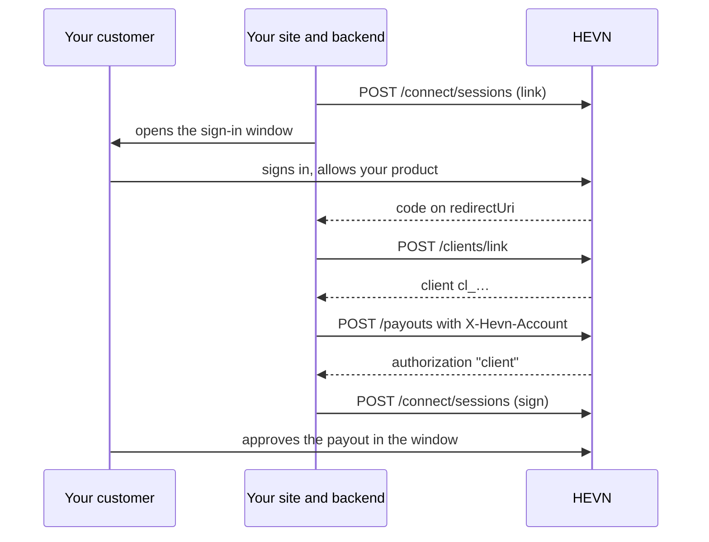

With HEVN Connect, your customer links a HEVN account to you in a HEVN-hosted sign-in window and approves each payout there. Start with `POST /dapi/v1/connect/sessions`, which returns the URL your site opens in a popup.

It is the recommended integration. HEVN provides the wallet, the sign-in and the approval screen, and your backend does the rest with its developer key.

## What a client is

A HEVN account is a profile plus a Base smart wallet. With HEVN Connect, a client is your customer's HEVN account, created in the [sign-in window](/connect/sign-in-with-hevn) and linked to you when the holder allows your product there.

The wallet is non-custodial. The holder's key is the signer on it, and HEVN holds no key to it ([Account structure](/general/what-is-hevn#account-structure)). Your developer key is not a signer on a client's wallet.

`POST /dapi/v1/clients/link` returns the client's `cl_…` id. Your backend sends it in `X-Hevn-Account` to act for that client ([Acting as a client](/developers/authentication#acting-as-a-client)).

## What your customer sees

HEVN Connect is not a full whitelabel. Your customer signs in to HEVN with Google or an email code, in a HEVN-hosted window that names your product, and approves payouts in the same window.

HEVN sets the window's title, logo and colours on request. The holder can also sign in to HEVN without your product.

To keep HEVN out of your interface, see [External wallets](/external-wallets/overview). That integration is enabled per integrator, and your product provides the wallet and its signing flow.

## Integration steps

| Step | Calls | Page |
| --- | --- | --- |
| Get access | Create a developer key, add your origins under **Allowed sites**, log in | [Authentication](/developers/authentication), [Configure the window](/connect/sign-in-with-hevn#configure-the-window) |
| Link a client | `POST /dapi/v1/connect/sessions` with `action: "link"`, the sign-in window, then `POST /dapi/v1/clients/link` | [Sign in with HEVN](/connect/sign-in-with-hevn#link-an-account) |
| Verify the client | A business: `PUT /dapi/v1/client/kyb`, then `POST /dapi/v1/client/kyb/complete`. An individual: a `verify` session | [Clients and verification](/developers/clients#write-the-document), [Verify an individual](/connect/sign-in-with-hevn#verify-an-individual) |
| Take money in | `POST /dapi/v1/banks` requests a virtual account, `POST /dapi/v1/payins` quotes an incoming payment | [Virtual accounts](/developers/virtual-accounts), [Payins](/developers/payins) |
| Pay money out | `POST /dapi/v1/contacts`, `POST /dapi/v1/payouts`, then a `sign` session the holder approves | [Money movement](/connect/money-movement) |
| Read the ledger | `GET /dapi/v1/client/balance`, `GET /dapi/v1/transactions` | [Balances and transactions](/developers/balances-and-transactions) |

HEVN activates your integrator account before the first step works ([What HEVN must enable](/developers/sandbox#what-hevn-must-enable)).

## Who signs

A payout booked for a linked client returns `authorization: "client"` and no `approval`. The holder signs it in a `sign` session ([Authorization values](/developers/signing#authorization-values)).

| For a linked client | Your developer key | The holder, in the window |
| --- | --- | --- |
| Read the profile, balance and ledger | Yes | n/a |
| Update phone and address, write and submit KYB, upload documents | Yes | n/a |
| Request virtual accounts, quote payins, save contacts | Yes | n/a |
| Book or preview a payout | Yes | n/a |
| Approve a payout | No. A confirm returns `403 account_not_controlled` | Yes, in a `sign` session |
| Verify an individual's identity | No | Yes, in a `verify` session |
| Create a swap, fund an escrow deal, open a sub account | No. Each returns `403 account_not_controlled` | Not offered in the window |

The refusals and their routes are in [Money movement](/connect/money-movement#refusals). Who signs for your own integrator account is in [Accounts and control](/developers/overview#accounts-and-control).

## What you build

| You build | HEVN provides |
| --- | --- |
| A button that opens the popup, and one static callback page | The sign-in window and the holder's wallet |
| Two server routes: create a session, exchange the code | The signed session URL and the one-time code |
| A server-side session that stores the `cl_…` id | Account records, virtual accounts through the partner bank, the ledger |
| The decision to pay and the prompt to the holder | Pricing, the approval screen and execution |

Bind each sign-in to the browser that started it, and exchange the code on your server ([Bind the session to this browser](/connect/sign-in-with-hevn#3-bind-the-session-to-this-browser)). Do not accept a client id from the browser.

<Card title="Next: Quickstart" icon="rocket" href="/connect/quickstart" />
