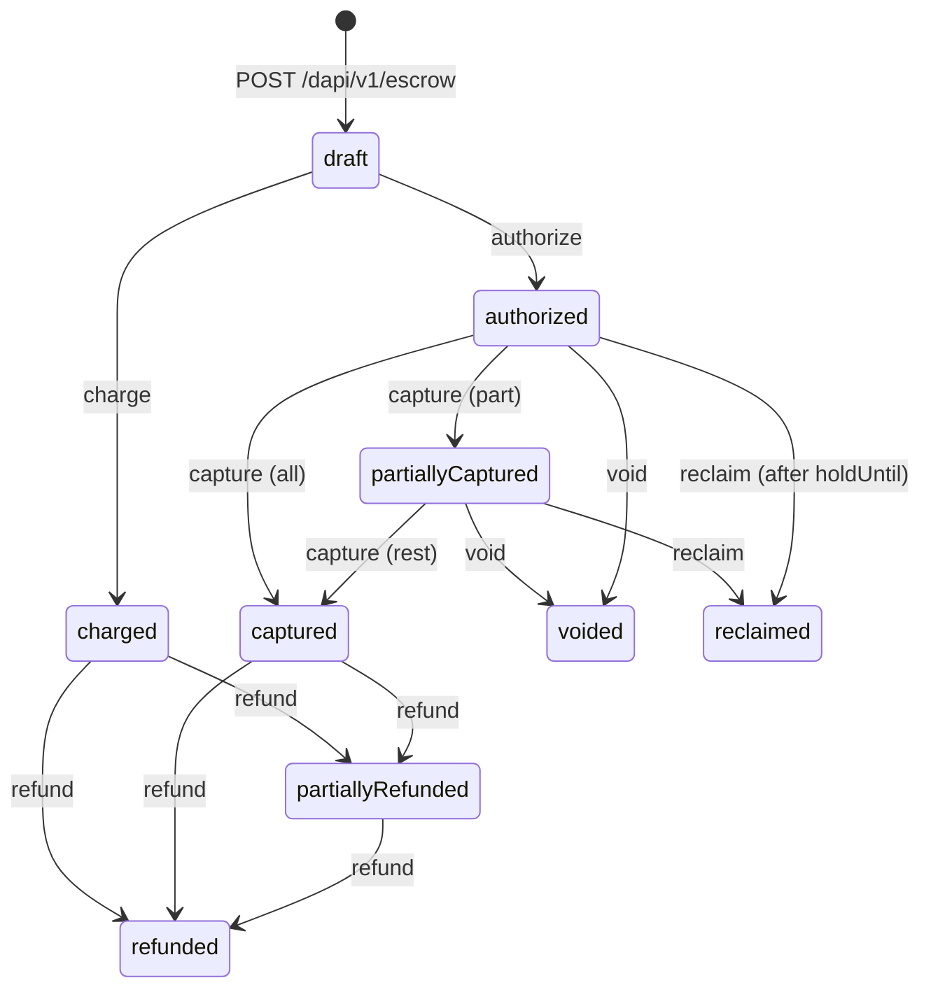

An escrow deal holds a buyer's funds in an on-chain contract until you capture them for the seller. Create a deal with `POST /dapi/v1/escrow`, then drive it with the operator actions in [The matrix](#the-matrix).



Escrow routes are self-scoped and refuse `X-Hevn-Account` ([Acting as a client](/developers/authentication#acting-as-a-client)). A deal moves money between main wallets, and a sub account takes no part in it.

<Warning>
  The buyer approves a deal with their key, and the [sign-in window](/connect/sign-in-with-hevn) does not offer escrow approvals. `POST /dapi/v1/escrow` with a buyer linked through Sign in with HEVN returns `403 account_not_controlled`. Contact HEVN before you build on escrow.
</Warning>

## Parties

| Party | Role |
| --- | --- |
| Sender | A client, the buyer. Funds the deal and approves its spend permission. Can `reclaim` an uncaptured hold after `holdUntil`. |
| Receiver | Another client, the seller. Receives what you capture. |
| Operator | You. Signs `authorize`, `charge`, `capture`, `void` and `refund` with your developer key on your wallet. |

The parties are different accounts. Sender and receiver are `ready` [clients](/developers/clients) linked to you through [Sign in with HEVN](/connect/sign-in-with-hevn). A referred account does not qualify. HEVN enables escrow for your account in both environments ([What HEVN must enable](/developers/sandbox#what-hevn-must-enable)).

The deal uses each party's Base smart wallet address at creation. Its terms are hashed into an on-chain payment record and cannot be changed.

## Amounts

`capturableAmount` is held in the contract. `refundableAmount` is paid to the seller and still refundable. Choose the next action from `availableActions` and these two amounts.

A draft not approved before `approveBy` stays `draft` with an empty `availableActions`. There is no `expired` status.

Amounts use the [money format](/developers/conventions#money), for example `"100.000000"` for USDC. Field meanings are on [Read one escrow](/api-reference/escrow/read-one-escrow).

## Windows

HEVN converts `approveWithin`, `holdFor` and `refundableFor` into the deadlines in `windows` when it creates the deal. Each window starts when the previous one ends. `void` has no window and is available while `capturableAmount` is positive.

Defaults, the duration format and the create refusals are on [Open an escrow](/api-reference/escrow/open-an-escrow-and-return-the-payers-approval).

## Fees

- `feeBps` on the deal is your fee ceiling. `capture` and `charge` take a fee up to it, paid to your Base smart wallet. There is no `feeReceiver` field.
- `refund` returns the gross amount from your wallet. The fee is not taken back.
- HEVN sponsors the gas for each action.

## Run an order

<Steps>
  <Step title="Create the deal">
    Call `POST /dapi/v1/escrow`. It moves no funds and prepares the approval that the buyer signs.

    <CodeGroup>
    ```python Python
    deal = hevn.post("/escrow", {
        "senderClientId": "cl_7YQ2Kf3mN8",
        "receiverClientId": "cl_2ABxR9dL4m",
        "token": "USDC",
        "maxAmount": "100.00",
        "approveWithin": "1h", "holdFor": "14d", "refundableFor": "90d",
        "feeBps": 250,
        "reference": {"orderId": "A-1187"},
    }, idempotency_key="order-A-1187")
    ```

    ```javascript Node
    const deal = await hevn.post("/escrow", {
      senderClientId: "cl_7YQ2Kf3mN8",
      receiverClientId: "cl_2ABxR9dL4m",
      token: "USDC",
      maxAmount: "100.00",
      approveWithin: "1h", holdFor: "14d", refundableFor: "90d",
      feeBps: 250,
      reference: { orderId: "A-1187" },
    }, { idempotencyKey: "order-A-1187" });
    ```

    ```go Go
    deal, err := api.Post("/escrow", hevn.Body{
    	"senderClientId":   "cl_7YQ2Kf3mN8",
    	"receiverClientId": "cl_2ABxR9dL4m",
    	"token":            "USDC",
    	"maxAmount":        "100.00",
    	"approveWithin":    "1h", "holdFor": "14d", "refundableFor": "90d",
    	"feeBps":    250,
    	"reference": hevn.Body{"orderId": "A-1187"},
    }, hevn.IdempotencyKey("order-A-1187"))
    ```
    </CodeGroup>

    ```json Response 201, Location: /dapi/v1/escrow/esc_5Qb4e17c9d
    {
      "id": "esc_5Qb4e17c9d",
      "status": "draft",
      "availableActions": ["approve"],
      "maxAmount": "100.000000", "authorizedAmount": "0.000000",
      "capturableAmount": "0.000000", "refundableAmount": "0.000000",
      "windows": { "approveBy": "2026-09-17T11:04:11Z",
                   "holdUntil": "2026-10-01T11:04:11Z",
                   "refundableUntil": "2026-12-30T11:04:11Z" },
      "action": { "action": "approve", "idempotencyKey": "order-A-1187",
                  "status": "awaitingSignature",
                  "approval": { "id": "a7c1…", "payload": "eyJ…",
                                "expiresAt": "2026-09-17T10:05:11Z" } },
      "…": "…"
    }
    ```

    Read the deal until `availableActions` is `["authorize", "charge"]`. The buyer's approval is then on chain.
  </Step>

  <Step title="Authorize the hold">
    Prepare `authorize` with `POST /dapi/v1/escrow/{escrowId}/actions`, then sign and confirm it as described in [Signing](/developers/signing). It moves the amount from the buyer's wallet into the contract. The wallet must hold the token when you confirm.

    A deal accepts `authorize` once. An amount below `maxAmount` leaves the remainder unusable.

    <CodeGroup>
    ```python Python
    action = hevn.post(f"/escrow/{deal['id']}/actions",
                       {"action": "authorize", "amount": "100.00"},
                       idempotency_key="order-A-1187-authorize")
    hevn.post(f"/escrow/{deal['id']}/actions/order-A-1187-authorize/confirm",
              {"signature": key.sign_payload(action["action"]["approval"]["payload"])})
    ```

    ```javascript Node
    const action = await hevn.post(`/escrow/${deal.id}/actions`,
      { action: "authorize", amount: "100.00" },
      { idempotencyKey: "order-A-1187-authorize" });

    await hevn.post(`/escrow/${deal.id}/actions/order-A-1187-authorize/confirm`,
      { signature: key.signPayload(action.action.approval.payload) });
    ```

    ```go Go
    action, err := api.Post("/escrow/"+deal.Str("id")+"/actions",
    	hevn.Body{"action": "authorize", "amount": "100.00"},
    	hevn.IdempotencyKey("order-A-1187-authorize"))

    signature, err := key.SignPayload(action.Str("action.approval.payload"))
    _, err = api.Post("/escrow/"+deal.Str("id")+"/actions/order-A-1187-authorize/confirm",
    	hevn.Body{"signature": signature})
    ```
    </CodeGroup>

    ```json Response 200
    { "deal": { "status": "authorized", "capturableAmount": "100.000000",
                "availableActions": ["capture", "void"], "…": "…" },
      "action": { "action": "authorize", "status": "confirmed",
                  "amount": "100.000000", "transactionHash": "0x3a77…", "…": "…" },
      "events": [ { "name": "PaymentAuthorized", "amount": "100.000000",
                    "transactionHash": "0x3a77…", "blockNumber": 19884412 } ] }
    ```
  </Step>

  <Step title="Capture with your fee">
    Before `holdUntil`, prepare and confirm `capture` the same way, with the body `{"action": "capture", "amount": "100.00", "feeBps": 250}` and the key `order-A-1187-capture`. You can repeat it up to `capturableAmount`.

    The seller receives 97.50 USDC and your wallet receives 2.50. The deal is `captured` with `refundableAmount: "100.000000"`.
  </Step>
</Steps>

## Cancel or refund

| Case | Action | Status |
| --- | --- | --- |
| Cancelled before capture | `void` | `voided` |
| Partly delivered | `capture` that part, then `void` | `partiallyCaptured`, then `voided`. The captured amount stays refundable. |
| Returned after capture | `refund` | `partiallyRefunded`, then `refunded` |
| Not captured before `holdUntil` | The buyer's `reclaim`, which you cannot send | `reclaimed` |

Keep the deal's token in your wallet for refunds. If the wallet cannot cover the amount, `refund` returns `409 simulation_failed`.

`void`, `refund` and `reclaim` remain available while your relationship with a client is paused or your profile is suspended.

## The matrix

Prepare an operator action with `POST /dapi/v1/escrow/{escrowId}/actions` and sign the returned payload. Then confirm it at `POST /dapi/v1/escrow/{escrowId}/actions/{idempotencyKey}/confirm`. The `amount` and `feeBps` rules are on [Prepare an escrow action](/api-reference/escrow/prepare-an-escrow-action-and-return-the-payload-to-sign).

| Action | Allowed when | Resulting status |
| --- | --- | --- |
| `authorize` | Before `approveBy`, while no funds are collected | `authorized` |
| `charge` | Before `approveBy`, while no funds are collected | `charged` |
| `capture` | Before `holdUntil`, repeatable | `partiallyCaptured`, then `captured` |
| `void` | While `capturableAmount` is positive | `voided` |
| `refund` | Before `refundableUntil`, repeatable | `partiallyRefunded`, then `refunded` |

`charge` is `authorize` and `capture` in one on-chain action, with no hold.

## Prepare an action

```json Request: POST /dapi/v1/escrow/esc_5Qb4e17c9d/actions, Idempotency-Key: order-A-1187-capture
{ "action": "capture", "amount": "40.00", "feeBps": 250 }
```

```json Response 201
{
  "deal": { "id": "esc_5Qb4e17c9d", "status": "authorized", "…": "…" },
  "action": { "action": "capture", "idempotencyKey": "order-A-1187-capture",
              "status": "awaitingSignature", "amount": "40.000000", "…": "…",
              "approval": { "id": "b1d0…", "payload": "eyJ…",
                            "expiresAt": "2026-09-17T10:31:02Z" } }
}
```

Confirm with `action.idempotencyKey` in the path. A replayed key returns the same record ([Idempotency-Key](/developers/conventions#idempotency-key)).

## Confirm an action

Sign the decoded bytes of `approval.payload` as described in [Signing](/developers/signing), then send the signature.

```json Request: POST /dapi/v1/escrow/esc_5Qb4e17c9d/actions/order-A-1187-capture/confirm
{ "signature": "MEUCIQDk3f8Zc0xq2w1Yv7pB9nH4mJ6sR2tL5uD8aE0cQ1oXgAIg…" }
```

| Response | Meaning | Next |
| --- | --- | --- |
| `200` | Mined. The body has the deal and its `events`. | Read `action.status`: `confirmed` or `reverted`. |
| `202` with `pollUrl` | The action is `submitted`. `pollUrl` is the deal read. | Call `POST /dapi/v1/escrow/{escrowId}/sync` while the action is `signing` or `submitted`. |
| `403 forbidden` | The developer key was deleted, or the IP is outside its [allowlist](/developers/authentication#the-ip-allowlist). The prepared action is unchanged. | Confirm from an allowlisted host. |
| `403 account_not_controlled` | The action would sign on the buyer's wallet. | Confirm operator actions only. |
| `410 approval_expired` | The approval closed, or none is open. | Prepare again with the same key. |
| `409 approval_consumed` | The approval was already used. | Read the deal, then prepare again with the same key. |
| `409 escrow_state_changed` | No capturable amount is left, or the payment was already collected. | Read the deal. Pick from `availableActions`. |

`400 signature_invalid`, `503 bundler_rejected` and `503 bundler_unavailable` are handled as in [Retrying a confirm](/developers/signing#retrying-a-confirm).

### Action in flight

A signing wallet runs one on-chain action at a time across all its deals. While one is `signing` or `submitted`, the next prepare or confirm returns `409 action_in_flight` with no `details`.

Queue actions per signing wallet and store the id of the deal in flight. Sync that deal before you retry.

## Statuses

`status` records the last transition. Choose the next action from `availableActions` ([Amounts](#amounts)).

| Deal status | Meaning | Next |
| --- | --- | --- |
| `draft` | No funds held. The buyer's approval does not change the status. | `authorize` or `charge`, after the buyer's approval |
| `authorized` | The hold is in the contract. | `capture` or `void` |
| `charged` | Paid to the seller in one action. | `refund` |
| `partiallyCaptured` | Part of the hold was paid to the seller. | `capture` or `void` |
| `captured` | No capturable amount is left. | `refund` |
| `voided` | The hold returned to the buyer. | `refund` if part was captured |
| `reclaimed` | The buyer took the hold back after `holdUntil`. | `refund` if part was captured |
| `partiallyRefunded` | Part was refunded from your wallet. | `refund` |
| `refunded` | The paid amount was refunded from your wallet. | n/a |

| Action status | Meaning | Next |
| --- | --- | --- |
| `awaitingSignature` | Prepared, with an open approval. | Sign and confirm within 60 seconds. |
| `signing` | Confirm in progress. | Wait. Do not prepare again. |
| `submitted` | Sent to the bundler, with no receipt yet. | Sync the deal as described in [Reads](#reads). |
| `confirmed` | Mined and applied to the deal. | n/a |
| `reverted` | Mined and reverted. No funds moved. | Read the deal. Prepare again with a new key. |
| `failed` | Not sent to the bundler. | Prepare again with the same key. |
| `dropped` | No receipt within the timeout. | Keep syncing. It can confirm for up to 24 hours. |
| `superseded` | Replaced by a later prepare. | Ignore. |

## Reads

`GET /dapi/v1/escrow/{escrowId}` returns one deal with its last action. There is no action list.

`GET /dapi/v1/escrow` lists the deals you operate ([List the escrows](/api-reference/escrow/list-the-escrows-this-account-operates)).

<CodeGroup>

```bash cURL
curl "$HEVN_API/escrow?status=authorized&status=partiallyCaptured&limit=50" \
  -H "Authorization: Bearer $HEVN_ACCESS_TOKEN"
```

```python Python
open_deals = hevn.get("/escrow?status=authorized&status=partiallyCaptured&limit=50")["items"]
```

```javascript Node
const { items: openDeals } =
  await hevn.get("/escrow?status=authorized&status=partiallyCaptured&limit=50");
```

```go Go
page, err := api.Get("/escrow?status=authorized&status=partiallyCaptured&limit=50")
openDeals := page.List("items")
```

</CodeGroup>

Write a repeated `status` into the path, because the HTTP client's parameter map holds one value per name.

`POST /dapi/v1/escrow/{escrowId}/sync` reconciles the deal with the chain and returns it with `consistent` ([Reconcile one escrow](/api-reference/escrow/reconcile-one-escrow-with-the-chain)).

## Errors

A closed window, a fee above the ceiling or an amount above the cap returns `400 invalid_request` with no `details`. There is no `window_closed` or `amount_out_of_range` code. Read the deal and pick from `availableActions`. Other codes are in [Errors](/developers/reference/errors#escrow).

<Card title="Next: Sandbox" icon="flask" href="/developers/sandbox" />
