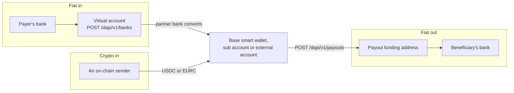

The `/dapi/v1` API lets your backend onboard customers, open virtual accounts for them and move their money. Choose an integration kind below, then log in with `POST /dapi/v1/auth/challenge` and `POST /dapi/v1/auth/token`.

## Integration kinds

Both kinds use the same API, the same developer key and the same sandbox. They differ in who holds the customer's wallet and how a payout is authorized.

| | HEVN Connect | External wallets |
| --- | --- | --- |
| Status | Recommended | For integrators that run their own wallet infrastructure. HEVN enables it per integrator. |
| Customer's wallet | The Base smart wallet of the customer's HEVN account | A wallet address the customer holds outside HEVN |
| How a client is created | The customer signs in through the sign-in window on your site, then you call `POST /dapi/v1/clients/link` | You call `POST /dapi/v1/clients`, then register the address with `POST /dapi/v1/client/accounts` |
| Who can be a client | A business or an individual | A company |
| Money in | Settles on the client's Base smart wallet | Settles as USDC on the registered address |
| Payout | `authorization: "client"`. The holder signs in the sign-in window. | `authorization: "wallet"`. The customer's wallet sends one USDC transfer. |
| HEVN in your UI | The sign-in window | None |

HEVN Connect needs no wallet infrastructure of your own. HEVN provides the wallet and the signing screen.

External wallets is a full whitelabel. Before HEVN enables `POST /dapi/v1/clients` for you, you show that your customers hold the keys to their wallets and that your wallet infrastructure is non-custodial.

<CardGroup cols={2}>
  <Card title="HEVN Connect" icon="log-in" href="/connect/overview" />
  <Card title="External wallets" icon="wallet" href="/external-wallets/overview" />
</CardGroup>

### Sub accounts

A sub account is a further wallet of your own integrator account on Base, with its own address, balance, ledger and virtual accounts. Your developer key signs for it. You open sub accounts on your own account, and a request that acts for a client returns `403 account_not_controlled`. See [Sub accounts](/sub-accounts/overview).

## API access

1. Ask HEVN to activate your integrator account, in the sandbox and in production ([What HEVN must enable](/developers/sandbox#what-hevn-must-enable)).
2. Create a developer key in the HEVN app. A key has an IP allowlist and no scopes ([Authentication](/developers/authentication#developer-key)).
3. Log in from your backend and send the access token as a bearer ([Sessions](/developers/authentication#sessions)).

Your integrator account and each client linked through HEVN Connect are HEVN accounts: a profile plus a Base smart wallet. A client created with `POST /dapi/v1/clients` is a profile with no wallet at HEVN.

## API layout

Each call acts on your integrator account, or on the client named in `X-Hevn-Account` ([Acting as a client](/developers/authentication#acting-as-a-client)).

| Resource | Routes under `/dapi/v1` | Page |
| --- | --- | --- |
| Session | `/auth/challenge`, `/auth/token`, `/auth/refresh` | [Authentication](/developers/authentication) |
| Clients | `/clients`, `/clients/link`, `/connect/sessions`, `/client` | [Clients and verification](/developers/clients) |
| Verification | `/client/kyb`, `/documents` | [Clients and verification](/developers/clients#write-the-document) |
| External accounts and sub accounts | `/client/accounts` | [Accounts](/developers/accounts) |
| Virtual accounts | `/banks` | [Virtual accounts](/developers/virtual-accounts) |
| Payins | `/payins` | [Payins](/developers/payins) |
| Payouts | `/contacts`, `/payouts` | [Payouts](/developers/payouts) |
| Swaps and moves | `/swaps` | [Swaps](/developers/swaps) |
| Balance and ledger | `/client/balance`, `/transactions` | [Balances and transactions](/developers/balances-and-transactions) |
| Escrow, enabled per integrator | `/escrow` | [Escrow](/developers/escrow) |
| Emulation | `/sandbox/*` | [Sandbox](/developers/sandbox) |

A payment from your own account is prepared, signed with the developer key and confirmed ([Signing](/developers/signing)). Formats, idempotency and polling are in [Conventions](/developers/conventions). The API sends no webhooks.

## Base URLs

| Environment | Base URL |
| --- | --- |
| Sandbox | `https://sandbox-api.hevn.finance/dapi/v1` |
| Production | `https://api.hevn.finance/dapi/v1` |

Browse the spec at [`/dapi/v1/docs`](https://sandbox-api.hevn.finance/dapi/v1/docs) or fetch the schema from `/dapi/v1/openapi.json`.

## How money moves

Money arrives through a virtual account or an on-chain transfer and leaves through a payout to a contact. It settles on a Base smart wallet, a sub account or an external account.

### Account keys

An account key names one balance of a HEVN account. `GET /dapi/v1/client/balance` returns one row in `accounts[]` per balance the account holds: its tokens, `FDIC_USD` and each sub account.

| Account key | Held | Currency |
| --- | --- | --- |
| `USDC` | On the account's Base smart wallet, `baseSmartWallet` | USD |
| `EURC` | On the same wallet | EUR |
| `RD` | On the same wallet, a second dollar token, when HEVN has switched the `RD` account on | USD |
| `USDC_ARB` | The same wallet address on Arbitrum | USD |
| `FDIC_USD` | At the partner bank, when the account holds it | USD |
| `FDIC_EUR` | At the partner bank, when the account holds it. `GET /dapi/v1/client/balance` returns no row for it | EUR |

The token rows are read on chain. `FDIC_USD` and `FDIC_EUR` are account identifiers for a balance held at a partner bank. The name is an identifier and says nothing about deposit insurance.

`sourceAccount` and `destinationAccount` take an account key or the `acc_…` id of an external account or a sub account ([Accounts](/developers/accounts)). `USDC_ARB` holds and receives, and payins and payouts refuse it with `422 account_not_supported`.

A virtual account record has `destinationAccount`, the account key its rail settles into, and `supportedAccounts`.

### Money in

| Path | Result | Page |
| --- | --- | --- |
| Bank transfer to a virtual account | The partner bank converts it at the rail's rate and delivers the settlement token, minus the rail's `feeBps`. A payin quote is optional. | [Virtual accounts](/developers/virtual-accounts) |
| Quoted payin | `POST /dapi/v1/payins` takes either `rail` or `originChainId`. `POST /dapi/v1/payins/{payinId}/instructions` returns what the payer needs. | [Payins](/developers/payins) |
| Transfer to `baseSmartWallet` or to a sub account address | The amount is in the balance once the transfer confirms. No payin record is created. | [Payins](/developers/payins#direct-crypto) |

<Warning>
  Send USDC or EURC on Base to `baseSmartWallet`. A token HEVN does not track does not become a balance or a transaction.
</Warning>

### Money out

`POST /dapi/v1/payouts` books a payout. Its `quote` has the amount that leaves the balance and the amount that arrives.

| Contact | The paying account sends to | Then |
| --- | --- | --- |
| Bank | The funding address for this payout | The partner bank pays the beneficiary's bank. |
| Wallet on Base | The contact's address, from the `sourceAccount` you name | No conversion, so both quote amounts are equal. |
| Wallet on another chain or token | A one-time address for the route | The payout is routed across chains and priced in `quote` ([Payouts](/developers/payouts#a-routed-payout-is-priced)). |
| Email of a HEVN account | The wallet of the HEVN account with that email | See [Payouts](/developers/payouts). |

Send `amount` or `amountTo`, as described in [Money](/developers/conventions#money).

### Status

A payout is complete when `GET /dapi/v1/payouts/{payoutId}` returns `settled`. Fiat timing is set by the partner bank. Poll as described in [Status codes](/developers/conventions#status-codes).

Completed payins and payouts are rows in `GET /dapi/v1/transactions` ([Balances and transactions](/developers/balances-and-transactions)).

## Accounts and control

Your developer key signs for your integrator wallet and its sub accounts. A client's wallet belongs to its holder, and the holder's key signs each spend from it.

`X-Hevn-Account` selects whose data a call reads and writes. It does not let the developer key sign for another account's wallet.

### Who can spend

`authorization` on the response of `POST /dapi/v1/payouts` and `POST /dapi/v1/swaps` names who authorizes the payment. The values are defined in [Authorization values](/developers/signing#authorization-values).

| Operation | `authorization` | Who signs |
| --- | --- | --- |
| A payout or swap from your main wallet | `debit` or `intent` | Your developer key, co-signed by HEVN ([Signing](/developers/signing)) |
| A payout or move from one of your sub accounts | `debit` | Your developer key, co-signed by HEVN ([Sub accounts](/sub-accounts/money-movement)) |
| An operator action on an escrow deal you run | n/a | Your developer key, co-signed by HEVN ([Escrow](/developers/escrow#the-matrix)) |
| A payout for a client linked through HEVN Connect | `client` | The holder, in the sign-in window ([HEVN Connect](/connect/money-movement)) |
| A payout from a client's external account | `wallet` | The customer's wallet, which sends the transfer ([External wallets](/external-wallets/money-movement)) |

For a client, these calls return `403 account_not_controlled` with `details.clientId`:

- `POST /dapi/v1/payouts/{payoutId}/confirm`, `POST /dapi/v1/swaps` and `POST /dapi/v1/swaps/{swapId}/confirm`.
- `POST /dapi/v1/payouts` from the main wallet of a client that is not linked through HEVN Connect.
- `POST /dapi/v1/client/accounts` with `kind: "sub"`.

| Question | Answer |
| --- | --- |
| Can you move a client's money? | No. Your developer key is not a signer on a client's wallet or on an external account. |
| Can HEVN move a client's money without the holder? | No. HEVN holds no key to the client's wallet or to an external account. |
| Can the holder move their balance? | Yes. They sign each payout you book. A HEVN Connect holder can also sign in to HEVN without your product. |
| What can HEVN do to a client balance? | HEVN can stop building new operations for a paused integrator. It cannot spend the balance or reverse a payment. |
| Who decides which beneficiaries a client may pay? | The partner bank, through the refusals a payout returns. HEVN does not choose beneficiaries. |

The holder's key on a HEVN account is an embedded wallet managed by [Privy](/general/security-model#keys-and-privy). See [Account structure](/general/what-is-hevn#account-structure).

### What this means for your product

HEVN authenticates your key and does not see your user. Your server chooses the client for each request and sends it in `X-Hevn-Account`:

- Keep the `cl_…` in your signed session. Do not accept a client id from a request body or a query string.
- With HEVN Connect, bind each sign-in to the browser that started it and exchange the link code on your server ([Sign in with HEVN](/connect/sign-in-with-hevn#3-bind-the-session-to-this-browser)).
- With external wallets, show the customer the `transfer` of a payout before their wallet signs it ([External wallets](/external-wallets/money-movement)).

A leaked developer key works from addresses on its [IP allowlist](/developers/authentication#the-ip-allowlist) until you delete it. Whoever has it can read and configure your clients, book client payouts that wait for the holder or the customer's wallet, and spend from your integrator wallet and its sub accounts. The key cannot spend a client balance.

To recover, create a new key, deploy it and delete the old one. HEVN refuses the next request made with a deleted key. See [Rotate a key](/developers/authentication#rotate-a-key).

## Responsibilities

| You build | HEVN provides |
| --- | --- |
| Your product UI | Account records, virtual accounts through the partner bank, on-chain balances, the ledger |
| The onboarding form | Submission to the partner bank and the review status |
| The decision to pay and the prompt to the customer | Pricing, execution and the receipt |
| With HEVN Connect, two pages for the sign-in window | The wallet, the sign-in window and its approval screen |
| With external wallets, the wallet, its key handling and its signing flow | The transfer each payout needs, and matching of the transfer once it is mined |

<Card title="Next: Authentication" icon="key" href="/developers/authentication" />
