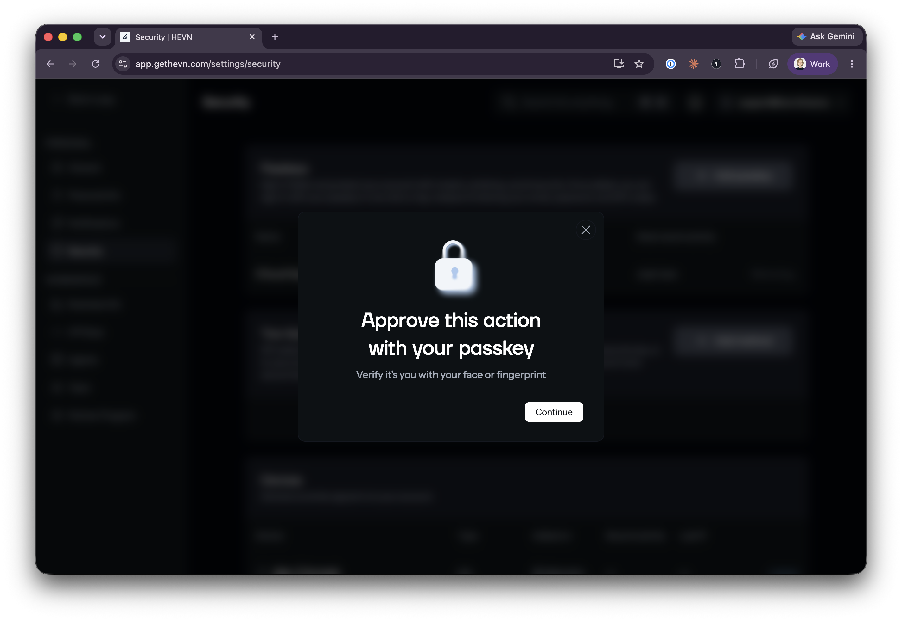

Funds in a HEVN account move by a signature from a wallet owner key, which HEVN does not hold. Before you fund an account, enroll wallet MFA and link a second login method.

## Who can do what

| Action | Holder (email + Privy) | HEVN | Partner bank | 1Click |
| --- | --- | --- | --- | --- |
| Spend from the smart wallet | Yes, by signature | No | No | No |
| Add or remove wallet owners | Yes, onchain | No | No | No |
| Create invoices and contacts, request a virtual account | Yes, with the JWT | Records them and requests the account details | Opens the virtual account | n/a |
| Make a fiat payout | Initiates and funds | Passes the payout details to the partner bank | Pays the beneficiary | n/a |
| Swap cross-chain | Initiates and funds | Requests the quote | n/a | Executes through a one-time address |

A co-owner signs like the holder. A remote transfer key or teammate with limited access is capped by its [spend permission](#shared-access).

## Keys and Privy

The owner key is a [Privy](https://privy.io) embedded wallet unlocked by email or Google login. HEVN stores no password, and the wallet has no seed phrase. According to Privy, the key is split into shares and reassembled for each signature inside a trusted execution environment, so neither Privy nor HEVN sees it. See [Privy security](https://www.privy.io/security).

The holder can [export the key](https://docs.privy.io/wallets/wallets/export) on a separate origin that HEVN and Privy do not see, and sign with standard Ethereum tooling while HEVN or Privy is offline. An exported key is a plaintext secret outside Privy's protections.

After the holder enrolls [wallet MFA](https://docs.privy.io/authentication/user-authentication/mfa/overview), signing, sending, export and recovery need a second factor. Prefer a passkey or an authenticator app to SMS. Manage factors under **Security** in the app settings.

<Frame caption="Passkey prompt for a key operation">
  
</Frame>

## Smart wallet

The wallet is an unmodified [Coinbase Smart Wallet](https://github.com/coinbase/smart-wallet) on [Base](https://docs.base.org/base-account/overview/what-is-base-account). Its owners are stored onchain, and anyone can check on [Basescan](https://basescan.org) that no HEVN key is among them.

Transfers, owner changes and upgrades each need an owner signature. HEVN holds no upgrade key or pause switch. HEVN sponsors gas through the [Coinbase Developer Platform Paymaster](https://docs.cdp.coinbase.com/paymaster/docs/welcome), so holders pay in USDC and hold no ETH. The paymaster cannot initiate or alter an operation.

Each operation has a unique nonce, so a retried submission executes at most once. For a fiat payout or a cross-chain transfer, the app derives the nonce from the one-time address, so a second transfer to that address is rejected. API [idempotency keys](/whitelabel/conventions#idempotency-key) are a separate check.

## Contract addresses

These are the canonical deployments from [coinbase/smart-wallet](https://github.com/coinbase/smart-wallet) and [coinbase/spend-permissions](https://github.com/coinbase/spend-permissions). Compare the verified bytecode on Basescan with the source.

| Contract | Address |
| --- | --- |
| Coinbase Smart Wallet Factory | [`0x0BA5ED0c6AA8c49038F819E587E2633c4A9F428a`](https://basescan.org/address/0x0BA5ED0c6AA8c49038F819E587E2633c4A9F428a) |
| ERC-4337 EntryPoint (v0.6) | [`0x5FF137D4b0FDCD49DcA30c7CF57E578a026d2789`](https://basescan.org/address/0x5FF137D4b0FDCD49DcA30c7CF57E578a026d2789) |
| SpendPermissionManager | [`0xf85210B21cC50302F477BA56686d2019dC9b67Ad`](https://basescan.org/address/0xf85210B21cC50302F477BA56686d2019dC9b67Ad) |
| USDC (Base) | [`0x833589fCD6eDb6E08f4c7C32D4f71b54bdA02913`](https://basescan.org/address/0x833589fCD6eDb6E08f4c7C32D4f71b54bdA02913) |

## Shared access

An owner can invite another HEVN user by email. The owner signs the grant, and HEVN cannot execute it without that signature.

| | Full access | Limited access |
| --- | --- | --- |
| Mechanism | Co-owner of the smart wallet | A [spend permission](https://docs.base.org/base-account/improve-ux/spend-permissions) |
| Can do | Spend the balance and add or remove owners | Spend one token up to an allowance per period |
| Revoke | Remove the owner onchain | Revoke the permission onchain |

The invitee signs with their Privy key, and users share no key material. Spend permissions and their usage are public on [Basescan](https://basescan.org). Revocation works while HEVN is offline.

Platform roles, such as who can see invoices, are separate from onchain rights. The HEVN API manages them under the JWT, and the app keeps both in sync.

## Signed responses

A signing service adds an Ed25519 signature to payout details, one-time addresses and transfer instructions from the partner bank and Privy before they reach the HEVN backend. The app verifies each payload before showing it or acting on it.

A compromised backend can delay or drop this data. A substituted address or account detail fails verification. Privy wallet activation and email-to-address resolution also run through a service that signs its responses.

## Failure scenarios

| Scenario | What is exposed | Next |
| --- | --- | --- |
| The HEVN backend is compromised or offline | Invoices, contacts and account details can be read and changed. No wallet operation can be signed. | Sign through Privy or with an exported key. |
| A remote transfer key leaks, or the backend is compromised while you have one | Spending through the key, up to its onchain allowance for the current period. The owner key is not exposed. | Delete the key in the app, which revokes its spend permission onchain. |
| The backend shows a false payout or payin address | You could sign a transfer to an attacker. The app rejects an address that fails signature verification. | Verify a large transfer's destination through another channel. |
| A JWT leaks | Data can be read and metadata edited. The JWT cannot spend. | n/a |
| Your email is compromised | Without wallet MFA, the attacker can unlock the wallet. With wallet MFA, each key operation also needs your passkey or OTP code. | Enroll wallet MFA. |
| You lose access to your email | Privy [cannot restore access or change login methods](https://www.privy.io/user-help-center), and HEVN cannot reassign your identity to a new email. | Link a second login method in advance, or add a trusted co-owner. |
| You lose an MFA factor | Removing or replacing a factor [requires MFA first](https://docs.privy.io/authentication/user-authentication/mfa/advanced). Losing the last factor locks wallet operations. | Enroll two factors (a passkey and an authenticator app), or add a trusted co-owner. |
| You lose your device | The device holds no unique secret, and there is no seed phrase. | Sign in on another device. |
| A user with shared access misuses it | A co-owner can spend the balance and remove you. A limited spender can spend the remaining allowance. | Revoke the access onchain. |

## Dependencies

| Dependency | If it fails | Bound |
| --- | --- | --- |
| Coinbase Smart Wallet contracts | A contract bug would affect all Base Account users. | Deployed unmodified at public [addresses](#contract-addresses). |
| Base | Transactions wait until Base resumes. | Public L2 with public explorers. |
| Privy (key management and the email-to-key mapping) | An outage or shutdown delays signing. | Sign with an exported key. |
| Partner bank (fiat leg of payins and payouts) | It holds fiat in transit, so a payin or payout in progress waits. | One one-time address per payout. |
| NEAR Intents 1Click | A failed or expired swap is refunded to the sender. | One swap at a time, bound to a quote. |
| Paymaster | Operations wait until it resumes. | It cannot initiate or alter an operation. |

## Protect your email

- Enroll wallet MFA.
- Turn on 2FA for the mailbox. Prefer a passkey or hardware key to SMS.
- Lock down recovery phone numbers and backup addresses.
- For a business account, use a dedicated, access-controlled mailbox.

## Responsible disclosure

Report a vulnerability privately to [p@gethevn.com](mailto:p@gethevn.com) with reproduction steps and impact. HEVN does not pursue legal action for good-faith research reported this way.
