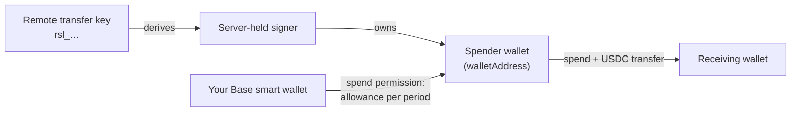

Remote transfers let a server, a script or an agent you run send USDC from your own HEVN account
without a person in the loop. You create a **remote transfer key** in the app, grant it a spend
permission from your smart wallet, and the key can then pay contacts, invoices, payout quotes and
email addresses over HTTP — never more than the allowance you granted for the current period.

<Warning>
  **For advanced use only.** A remote transfer key moves money with no approval step. For everyday
  payments use the app, or the HEVN assistant, which only files transfer requests that you approve
  yourself. Reach for a key only when a program you operate must pay on its own, and grant it the
  smallest allowance that does the job.
</Warning>

This tab is about your **own** account. If you are building a product that creates and operates
accounts for your customers, you want the [Whitelabel](/whitelabel/overview) API instead: it uses a
developer key and a different credential model, and the two never mix.

## How a transfer is authorized

| Piece | What it is |
| --- | --- |
| **Remote transfer key** | A secret starting `rsl_`, shown once when you create it. HEVN stores only its SHA-256 hash. Keys created before the rename start `mcp_` and keep working |
| **Spender wallet** | A Coinbase smart wallet of its own, one per key, returned as `walletAddress`. Its owners are a signer HEVN derives from your key and Coinbase's `SpendPermissionManager`. HEVN predicts the address at creation; the wallet deploys with the key's first transfer |
| **Spend permission** | An onchain allowance you sign from your smart wallet, naming the spender wallet, with an amount per period. It is the real limit — see [Shared account access](/general/shared-access#limited-access-spend-permissions) |
| **Transfer** | One sponsored ERC-4337 user operation from the spender wallet: `SpendPermissionManager.spend` pulls the amount out of your wallet, then a USDC `transfer` sends it on. You pay no gas |

Without an active spend permission the key cannot move a cent: every transfer answers
`403` until you grant one. The key never touches your own signing key, which stays in
[Privy](/general/privy-wallets).

## Limits that apply to every transfer

| Limit | Where it is enforced | What happens when it is hit |
| --- | --- | --- |
| **Spend permission allowance** | Onchain, by `SpendPermissionManager` | `400 Insufficient spend allowance` until the period resets |
| **`maxSpend`**, optional | HEVN, a lifetime ledger per key | `403 Spend limit exceeded for this API key` |
| **IP allowlist**, optional | HEVN, on every request | `403 IP not allowed` |
| **Rate limit** | HEVN, 60 requests per hour per key on `/transfer`, `/transfer_to_user` and `/resolve_address` | `429` with `Retry-After` |

The allowance is the only limit that holds even if HEVN itself misbehaves. `maxSpend` and the
allowlist are backend checks that narrow it further.

## A transfer runs at most once

Every transfer carries an ERC-4337 nonce derived from a payment id, and the spender wallet accepts each
nonce once. The payment id is `<keyId>_<reference>`, where the reference is the first of:

1. the `invoiceId` you pay,
2. the `quoteId` you fund,
3. the `Idempotency-Key` header you send.

A second request with the same payment id never executes: it answers `409 This transfer was already
sent`. That refusal comes from the wallet itself, so it holds across retries, restarts and concurrent
requests. Two consequences follow:

- A contact transfer **without** an `Idempotency-Key` gets a random reference and is never
  deduplicated. Always send the header when you pay a contact.
- The reference is scoped to the key. The same invoice paid through two different keys is two
  transfers.

## What you can do with a key

| Operation | Route |
| --- | --- |
| Read your USDC balance and the key's remaining allowance | `GET /get_balance` |
| Find the HEVN wallet for an email | `GET /resolve_address` |
| Pay a contact, an invoice or a payout quote | `POST /transfer` |
| Pay any email address, creating its HEVN account if needed | `POST /transfer_to_user` |
| List the email transfers this account made | `GET /transfers` |

There are no scopes: a valid key can call every route above. Treat it like a password with a budget.

<Card title="Next: Keys and permissions" icon="arrow-right" href="/remote-transfers/keys">
  Create a key, grant its spend permission, restrict it, and revoke it.
</Card>
