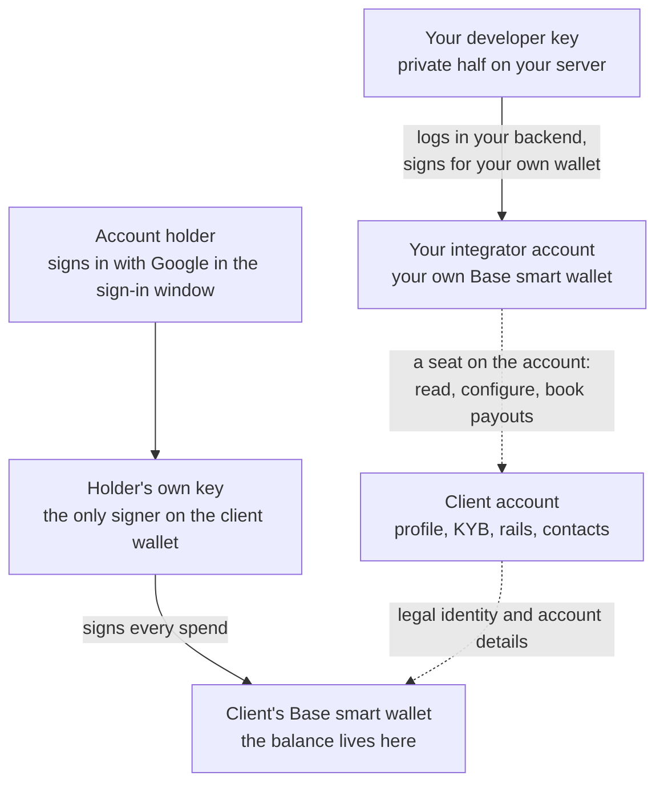

A client account belongs to its holder. You can operate it — verify it, open its rails, save its contacts, book its payouts — but only the holder's own key can spend from it, and HEVN cannot spend from it either.

## Two kinds of account, one wallet each

Your **integrator account** is an ordinary HEVN account that clients can be linked to. A **client** is your customer's own HEVN account — a company identity, a KYB subject, bank rails, contacts, a ledger, and a Base smart wallet of its own. The holder creates it in the [sign-in window](/whitelabel/sign-in-with-hevn) on your site, and allowing your product there gives your integrator account a seat on it.

The wallet is the money. `baseSmartWallet` on the client record is where deposits settle, what `GET /dapi/v1/client/balance` reads for the client in `X-Hevn-Account`, and what every payout debits. Client wallets are separate from each other and from yours: there is no pooled account and no omnibus balance anywhere in this product.

## Who can spend

The client's smart wallet is owned by the holder's own key, an embedded wallet behind their Google sign-in whose key never exists outside [Privy's key management](/general/privy-wallets). It is the self-serve model from the [General](/general/what-is-hevn) tab, unchanged: nothing leaves the wallet without that key's signature.

So a payout for a client is two parties' work:

1. **You book it.** `POST /dapi/v1/payouts` with the client in `X-Hevn-Account` prices the payment and books it. The response says `authorization: "client"` and carries nothing for your key to sign.
2. **The holder signs it.** You open the sign-in window for that payout; the holder signs in, sees the amount and the contact, and their wallet signs the debit.

| Question | Answer |
| --- | --- |
| Can you move a client's money? | No. You can book a payout; only the holder can sign it. Your developer key is never a signer on a client wallet. |
| Can HEVN move a client's money without the holder? | No. HEVN holds no key to the client's wallet. |
| Can the holder move their own balance? | Yes. It is their account. They sign every payout you book for them, and they can sign in to HEVN directly. |
| Can HEVN freeze or seize a client balance? | No. HEVN can stop building new operations for a paused integrator; it cannot spend or claw back. |
| Does HEVN decide who a client may pay? | The partner bank does, through the refusals a payout can return. HEVN never picks a beneficiary. |

<Note>
  An earlier version of this API created client accounts from your backend, with your developer key as their signer. That path is closed: a client exists only through Sign in with HEVN, and a developer key signs only for your own wallet.
</Note>

## What your developer key does

The [developer key](/whitelabel/developer-key) is your backend's credential, and it does two jobs:

- **It authenticates your backend.** A challenge signed by the key mints the session every `/dapi/v1` call carries. That session reads and configures every client linked to you, books their payouts and opens sign-in windows.
- **It signs for your own wallet.** Payouts and swaps from your integrator account, and the operator actions on [escrow](/whitelabel/escrow) deals you run, are approvals your key signs and HEVN co-signs, exactly as [Signing](/whitelabel/signing) describes.

It does nothing else. A route that would make your key sign for a client's wallet — a confirm on a client's payout or swap — answers `403 account_not_controlled`.

## What this means for your product

Your customer sees your product, and the sign-in window carries your brand. Two obligations follow.

**Your server decides which client a request is for.** HEVN authenticates your key, not your user. Bind each sign-in to the browser that started it, exchange the code server-side, and keep the `cl_…` in your own signed session — never take a client id from a request body or a query string. [Sign in with HEVN](/whitelabel/sign-in-with-hevn#3-bind-the-session-to-this-browser) shows the pattern.

**A leaked key exposes data and your own wallet, not your clients' money.** Until you delete it, whoever holds the key — from a network on its IP allowlist — can read and configure every client linked to you, book payouts that wait for a signature, and spend from your integrator wallet. It cannot spend a client balance: every one of those payouts still needs its holder in the window. Losing a key is not losing funds either: create a new key, deploy it, delete the old one. Deleting the key stops the next request made with it.

<Warning>
  Treat the developer key as the credential to your integrator wallet and to every client's data. Keep the private half in a secret manager, never in a browser, never in a repository, keep its allowlist as narrow as your deployment allows, and rehearse [rotation](/whitelabel/developer-key#rotate-a-key) before you need it.
</Warning>

## Acting for a client, in one sentence

Reads and writes on a client's data are the same API calls you would make for yourself, with `X-Hevn-Account: cl_…` added — one token, any client linked to you. Where that header is optional, where it is required and where it is refused is [Sessions](/whitelabel/sessions#acting-as-a-client).

<Card title="Next: Developer key" icon="key-round" href="/whitelabel/developer-key">
  Create it, load it, and rotate it without downtime.
</Card>
