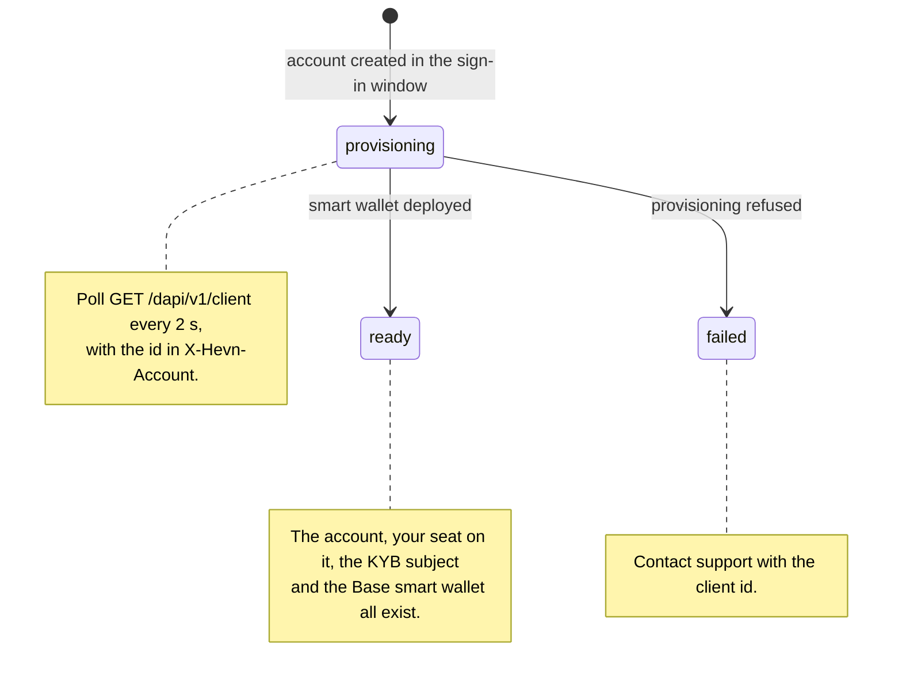

import PollSnippet from "/snippets/poll.mdx";

A client is your customer's own HEVN account, linked to your integrator account through [Sign in with HEVN](/whitelabel/sign-in-with-hevn). You do not create it with an API call: the account holder creates it in the sign-in window, and `POST /dapi/v1/clients/link` hands you its id.

```json POST /dapi/v1/clients/link — 200
{
  "id": "cl_7YQ2Kf3mN8",
  "status": "ready",
  "email": "ops@northwind.example",
  "baseSmartWallet": "0x2f1c9a3b7e5d41c8a06f2d9b4e7c15839af0d6b2",
  "kybStatus": "notStarted",
  "createdAt": "2026-09-17T10:04:11Z",
  "pollUrl": "/dapi/v1/client"
}
```

`email` is the address the holder signed in with. A newly created account has nothing else on it yet, so `name` and `phone` are usually absent: the company's identity goes into its [verification document](/whitelabel/onboarding), the phone in through `PATCH /dapi/v1/client`. Responses omit fields with no value, so an absent field and a null field are the same thing — see [conventions](/whitelabel/conventions).

Examples use the client from [HTTP client](/whitelabel/reference/client). This page straddles the two account scopes: `POST /dapi/v1/clients/link` and `GET /dapi/v1/clients` are about **your** account and **refuse** `X-Hevn-Account` with `400 account_scope_conflict`, while `GET /dapi/v1/client` and `PATCH /dapi/v1/client` act on one client and **require** it. [Sessions](/whitelabel/sessions#acting-as-a-client) has the whole table.

## Three statuses



`ready` means usable. It is the only signal you need before you write the client's KYB document, open a rail for it or book its payouts. A client the window just created is usually `ready` by the time you exchange the code; when it is still `provisioning`, wait for it.

## Wait until it is ready

`pollUrl` carries no id. It is literally `/dapi/v1/client`, the singular route that reads whichever account `X-Hevn-Account` names — so a poller sends the `cl_…` in that header rather than building a path from it.

<PollSnippet />

<CodeGroup>

```bash cURL
curl "$HEVN_API/client" \
  -H "Authorization: Bearer $HEVN_ACCESS_TOKEN" \
  -H "X-Hevn-Account: cl_7YQ2Kf3mN8"
```

```python Python
northwind = hevn.acting_as(client["id"])
client = poll_until(
    lambda: northwind.get("/client"),
    lambda c: c["status"] != "provisioning",
)
```

```javascript Node
const northwind = hevn.actingAs(client.id);
const ready = await pollUntil(
  () => northwind.get("/client"),
  (c) => c.status !== "provisioning",
);
```

```go Go
northwind := api.ActingAs(client.Str("id"))
ready, err := hevn.PollUntil(func() (hevn.Payload, error) {
	return northwind.Get("/client")
}, func(c hevn.Payload) bool { return c.Str("status") != "provisioning" }, 2*time.Minute)
```

</CodeGroup>

There is one id to store. `cl_7YQ2Kf3mN8` is what you put in `X-Hevn-Account`: to read this client, to write its KYB document, and to act for it on every money route. Nothing takes it in a path. Keep it in your own records against your own user, server-side — never accept it from a browser, where any page could substitute another customer's id. `baseSmartWallet` is the address that holds the client's balance; keep it for your own reconciliation, but no call takes it as an argument.

`kybStatus` follows the client's verification from here on — `notStarted`, then `pending`, `approved`, `rfi` or `rejected` — and `kybApplicationId` names the latest submission behind it. [Onboarding](/whitelabel/onboarding) owns that vocabulary; this row is where you read it without a second call.

A `failed` client answers with a `failure` object whose `code` is `provisioning_failed`, `request_rejected` or `request_canceled`. Contact support with the client id.

## List your clients

<CodeGroup>

```bash cURL
curl "$HEVN_API/clients?status=ready" \
  -H "Authorization: Bearer $HEVN_ACCESS_TOKEN"
```

```python Python
mine = hevn.get("/clients", {"status": "ready"})["items"]
```

```javascript Node
const { items: mine } = await hevn.get("/clients", { status: "ready" });
```

```go Go
page, err := api.Get("/clients", hevn.Query{"status": "ready"})
mine := page.List("items")
```

</CodeGroup>

`GET /dapi/v1/clients` answers `{ "items": [...], "nextCursor": "..." }`, every account connected to you, newest first. It takes `status` (`provisioning`, `ready`, `failed`), `email` as an exact, lowercased match, and cursor pagination. It is the place to recover an id you lost: a holder who signs in again through the window also gives you a fresh code for the same client.

## Update the phone and the address

`PATCH /dapi/v1/client` writes two things and nothing else — the phone number the rails check, and the postal address. It is a client-scoped route, so the id travels in `X-Hevn-Account`:

<CodeGroup>

```bash cURL
curl -X PATCH "$HEVN_API/client" \
  -H "Authorization: Bearer $HEVN_ACCESS_TOKEN" \
  -H "X-Hevn-Account: cl_7YQ2Kf3mN8" \
  -H "Content-Type: application/json" \
  -d '{"phone":"+13125550142"}'
```

```python Python
patched = hevn.acting_as(client_id).patch("/client", {"phone": "+13125550142"})
```

```javascript Node
const patched = await hevn.actingAs(clientId).patch("/client", { phone: "+13125550142" });
```

```go Go
patched, err := api.ActingAs(clientID).Patch("/client", hevn.Body{"phone": "+13125550142"})
```

</CodeGroup>

`phone` is E.164, for example `+13125550142`. Every rail a company opens checks for a phone number on the account, so set it before you [open one](/whitelabel/virtual-accounts). `address` takes `streetAddress`, `addressLine2`, `city`, `state` and `zip`. Only the keys you send are written.

Everything else a company has to tell HEVN is verification data and belongs in its KYB document. The address country is frozen at registration; changing a locked field answers `409 profile_locked` with `details.fields`.

## What you can do with a client

Linking gives your integrator account a seat on the client's account. With it you read and write everything a finance team would set up — the verification document, rails, contacts, payins, the ledger — and you **book** payouts. You never **sign** them: the account holder's own key is the only one that can spend from their wallet, and they approve each payout in the [sign-in window](/whitelabel/sign-in-with-hevn#approve-a-payout). Your developer key has no power over the client's money at all. That is the whole point of the model — see [accounts and control](/whitelabel/accounts-and-control).

<Card title="Next: Onboard a client" icon="arrow-right" href="/whitelabel/onboarding">
  Fill the KYB document, upload its papers, submit, and answer an RFI.
</Card>
