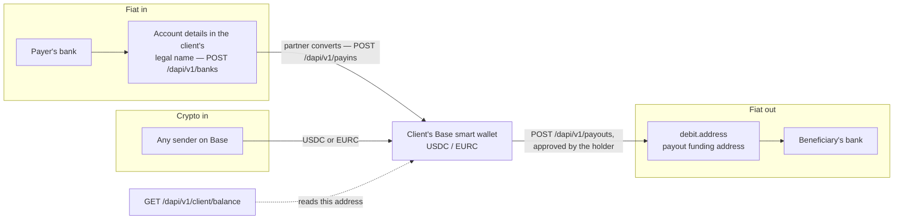

Every client balance is a stablecoin on one address. Everything else is a partner moving fiat to or
from it.

## A balance is a stablecoin on one address

Every client has a Base smart wallet of its own, created with the account when its holder signs up in
the [sign-in window](/whitelabel/sign-in-with-hevn), and reported as `baseSmartWallet`. That address is
the balance: `GET /dapi/v1/client/balance`, with the client's id
in `X-Hevn-Account`, reads it on chain, one row per account the client holds, and no HEVN database holds an
authoritative copy.

Two accounts sit there, each named after the stablecoin it holds: **`USDC`** and **`EURC`**. A
third, **`FDIC_USD`**, is not on the wallet at all — it is a virtual account a partner bank holds for
the client in dollars. Which account a rail settles into is the rail's `destinationAccount`, fixed
when the rail is opened and reported next to its `supportedAccounts`; per deposit,
`POST /dapi/v1/payins` takes the `destinationAccount` you want that arrival delivered in. Moving
money between two of a client's own accounts is its own resource — see [Swaps](/whitelabel/swaps).

## Fiat in is a conversion you priced

A rail is a bank route you request for one client. When the partner bank opens it, it publishes
**account details** — an IBAN, an account and routing number, a PIX key — in the client's own legal
name. Money wired there is
received by the partner bank, converted at the rate the rail quotes, and delivered to the client's
wallet into the account the rail settles into, minus the rail's `feeBps`.

You can price that arrival before it happens. `POST /dapi/v1/payins` quotes an incoming amount and
`POST /dapi/v1/payins/{payinId}/instructions` returns what the payer needs to see. Money that arrives
without a quote — an unsolicited wire to account details that are already live — still lands and still becomes an income
row; the quote exists so you can show your customer a number first.

Crypto in has two shapes. Anything sent to `baseSmartWallet` on Base is the client's balance the
moment it confirms — no rail, no quote, nothing to call. Or quote it first: `POST /dapi/v1/payins`
takes `originChainId` **instead of** `rail` — exactly one of the two — to price an incoming on-chain
transfer, and `POST /dapi/v1/payins/{payinId}/instructions` answers with the `address` to send to,
its `chainId`, and the `memo` that chain requires. `PayinView` then reports both
`originChainId` and `destinationChainId`.

## Every transfer out is a payout

There is one way money leaves a client, and one resource for it: `POST /dapi/v1/payouts`. Paying a
beneficiary's bank in another country, sending a stablecoin to an address on Base, moving money to
another HEVN account, paying an address on another chain — all of it is a payout, and each one is
**quoted** before it moves.

The quote is not a formality for the simple cases. A quote says three things every time: what leaves
the client's balance, what arrives, and the **deposit address** the on-chain operation must pay. A
bank payout's deposit address belongs to the partner that will do the fiat leg. A same-chain
transfer's deposit address is the contact's own address, and the two amounts are equal because nothing is
converted. Same shape, same fields, same confirm route — so the code you write for one destination
already works for the next, and the only thing that varies is what `quote` contains.

What follows from that is worth keeping in mind while you read the rest of this page: there is no
"simple transfer" shortcut to learn, no second idempotency story, and no second refusal vocabulary.
One resource, one approval by the holder, one `GET /dapi/v1/payouts/{payoutId}` to watch.

## Fiat out is funded from the wallet

`POST /dapi/v1/payouts` does the whole opening move: it prices the payment and books it with the
partner. The response carries the `quote` — what the beneficiary gets and what it costs — and
`authorization: "client"`, because the money is the client's and its holder signs. You open the
sign-in window for the payout; the holder sees the terms and their wallet signs the debit: an amount
of USDC to the funding address for this payout, a single-purpose address that the partner's fiat leg
consumes, not a balance HEVN keeps. The partner then pays the beneficiary's bank.

A payout from your own integrator account runs the same way, except that the response also carries
the `approval` and the `debit`, and your developer key signs them through
`POST /dapi/v1/payouts/{payoutId}/confirm` — see [Signing](/whitelabel/signing).

You pin one side of the payment and HEVN derives the other. Send `amount` to pin what leaves the
balance, or `amountTo` to pin what the beneficiary receives — never both, and never re-derive the
other side yourself.

A wallet contact is the same envelope with no fiat leg. `POST /dapi/v1/payouts` with a contact that
is an address, then the same approval, pays from an account — `USDC` or `EURC`,
whichever you name in `sourceAccount` — from the client's wallet straight to it. It is still quoted, and the quote's
deposit address is the contact's own address, so the debit lands where the contact says. No
conversion, no partner, no second resource to learn.

## Progress is read, not pushed

Only the chain leg is fast, and even it is not synchronous: the sign-in window returns `submitted` as
soon as the holder's wallet has sent the debit, before its receipt. Every fiat leg is slower than that
by a partner's business hours, so the state you act on comes from a read:
`GET /dapi/v1/payouts/{payoutId}`, `GET /dapi/v1/payins/{payinId}`, `GET /dapi/v1/banks`,
`GET /dapi/v1/client/balance`.

## One ledger per client

Both directions end in the same place: a transaction row on the client.
`GET /dapi/v1/transactions` with `X-Hevn-Account: cl_…` walks it newest first,
`GET /dapi/v1/transactions/summary` totals the same filters, and `GET /dapi/v1/transactions/export`
renders a statement. That ledger, not your own bookkeeping, is what a client's customer support answers from.

<Note>
  Every amount on the wire is a decimal string in the asset's major unit — `"500.00"`, never `500`
  and never `"500000000"`. See [Conventions](/whitelabel/conventions#money).
</Note>

<Card title="Next: Quickstart" icon="rocket" href="/whitelabel/quickstart">
  Do all of this once, in the sandbox, in about twenty minutes.
</Card>
