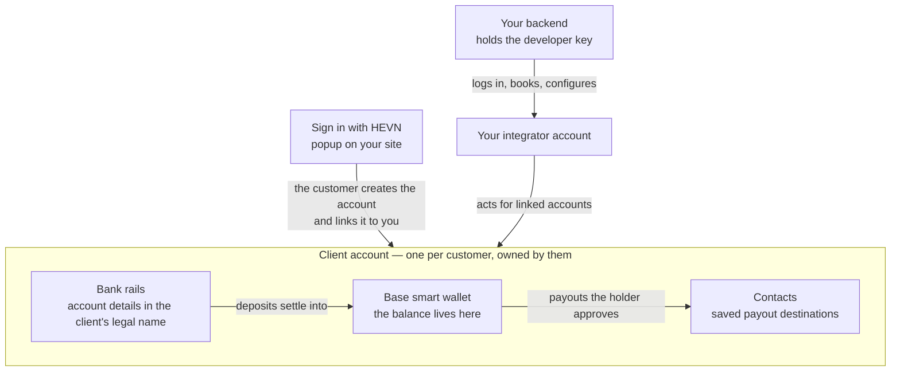

With the whitelabel API your customers get partner-bank payment details, a balance and outgoing payments inside your product. Each customer owns their HEVN account: they create it in a HEVN sign-in popup on your site, your backend operates it, and they approve every payment that leaves it.

## What you can build

- **A payroll or payables platform.** Collect from an employer, pay contractors to their own bank
  accounts in their own currencies.
- **An embedded payments account.** Give each of your customers payment details in their own company
  name, a balance, a statement and outgoing payments, under your brand.
- **A marketplace with on-chain escrow.** Lock a buyer's funds in a contract while a seller
  delivers, then capture them minus your fee. Escrow approvals by linked buyers are not available
  yet — see [Escrow](/whitelabel/escrow).

All three are assembled from the same five moves, in different orders —
[What you can build](/whitelabel/use-cases) takes each one end to end.

## How it works

You hold one HEVN account — your **integrator account**. Your customers' accounts are linked to it,
one per customer. Those are your **clients**. Each client is a real account that belongs to its
holder: it has a legal identity you submit for review once, **rails** that produce account details in
its own name, a balance, and a ledger.

A client comes from [Sign in with HEVN](/whitelabel/sign-in-with-hevn). Your page opens a
HEVN-hosted popup, your customer signs in with Google and allows your product to act on the account,
and your backend exchanges the code that comes back for the client's id. The popup carries your title,
logo and colours, and no HEVN product screens.

Every client balance is a stablecoin balance on that client's own Base smart wallet. Fiat arriving
over a rail is converted by a partner bank and settles into that wallet; fiat leaving is the same
journey in reverse. See [How money moves](/whitelabel/how-money-moves).

Your backend authenticates with a **developer key** — a P-256 keypair whose private half never leaves
your server. You register its public half once, together with the source IPs it may be used from,
and the session it mints reaches this API and nothing else. With it you read and configure every
client and book their payouts. You never sign them: a client's payout comes back with
`authorization: "client"`, and its holder approves it in the same popup. Your key signs only for your
own account. See [Accounts and control](/whitelabel/accounts-and-control).

A client becomes usable by passing four gates in order — linked, verification document complete,
application approved, rail active. After that, one payment is two calls and one click:
`POST /dapi/v1/payouts` books and prices it, `POST /dapi/v1/connect/sessions` opens the window for
it, and the holder approves.

Every route on these pages sits under `https://api.hevn.finance/dapi/v1`, or
`https://sandbox-api.hevn.finance/dapi/v1` in the sandbox. The spec is served by the API itself:
browse it at [`/dapi/v1/docs`](https://sandbox-api.hevn.finance/dapi/v1/docs) and fetch the schema
from `/dapi/v1/openapi.json`.

## What you get from HEVN, and what you keep

| You build | HEVN provides |
| --- | --- |
| Your product, your UI, your customer relationship | The account records, the sign-in window, the partner-bank rails, the on-chain balances, the ledger |
| The onboarding form your customer fills in | The submission to the partner bank, and the review status you read back from it |
| The decision to pay, and the moment you ask the holder | The pricing, the approval screen, the execution and the receipt |

One thing HEVN switches on for you rather than the API: your integrator account itself. It is a
conversation, in the sandbox as in production — see [Going live](/whitelabel/going-live).

## Where to start

<CardGroup cols={3}>
  <Card title="What you can build" icon="blocks" href="/whitelabel/use-cases">
    Three products assembled out of the five moves every integration is made of.
  </Card>
  <Card title="Quickstart" icon="rocket" href="/whitelabel/quickstart">
    Ten steps in the sandbox: a linked client that holds testnet USDC and has sent some of it out, approved by its holder.
  </Card>
  <Card title="Sign in with HEVN" icon="log-in" href="/whitelabel/sign-in-with-hevn">
    The popup that links a customer's account and approves their payouts.
  </Card>
  <Card title="Accounts and control" icon="shield" href="/whitelabel/accounts-and-control">
    Who owns a client account, who can move its money, and what happens if your key leaks.
  </Card>
</CardGroup>
