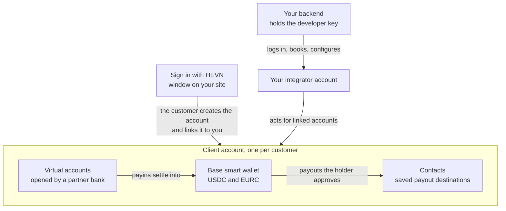
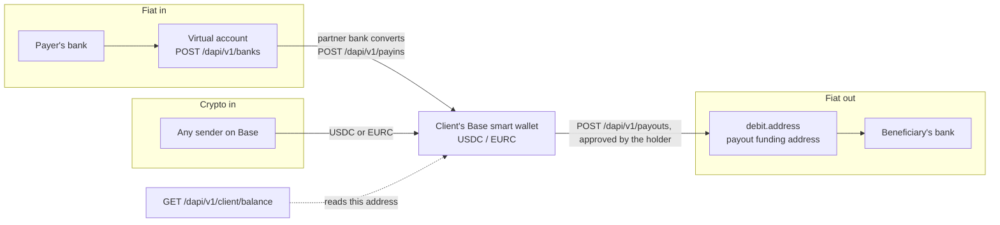

The whitelabel API lets your backend operate HEVN accounts that your customers hold. Start with the [Quickstart](/whitelabel/quickstart), which links one client through `POST /dapi/v1/clients/link` in the sandbox.

Your integrator account and each client are HEVN accounts: a profile plus a Base smart wallet. HEVN activates your integrator account on request, in the sandbox and in production ([Going live](/whitelabel/sandbox#what-hevn-must-enable)).

A client is a customer's HEVN account linked to your integrator account. The holder creates it in the [sign-in window](/whitelabel/sign-in-with-hevn). When the holder allows your product there, the client is linked to you.

## Integration steps

| Step | Calls | Page |
| --- | --- | --- |
| Link a client | `POST /dapi/v1/connect/sessions` with `action: "link"`, the sign-in window, then `POST /dapi/v1/clients/link` | [Sign in with HEVN](/whitelabel/sign-in-with-hevn), [Clients](/whitelabel/clients) |
| Verify the client | `PUT /dapi/v1/client/kyb` until `ready: true`, then `POST /dapi/v1/client/kyb/complete` | [Clients and verification](/whitelabel/clients#write-the-document) |
| Take money in | `POST /dapi/v1/banks` requests a virtual account, `POST /dapi/v1/payins` quotes an incoming payment | [Virtual accounts](/whitelabel/virtual-accounts), [Payins](/whitelabel/payins) |
| Pay money out | `POST /dapi/v1/contacts`, then `POST /dapi/v1/payouts` and a `sign` session the holder approves | [Payouts](/whitelabel/payouts) |
| Read the ledger | `GET /dapi/v1/transactions`, `/summary`, `/export` | [Balances and transactions](/whitelabel/balances-and-transactions) |
| Hold funds in escrow | `POST /dapi/v1/escrow`, then `POST /dapi/v1/escrow/{escrowId}/actions` (enabled per integrator) | [Escrow](/whitelabel/escrow) |

The customer links the account and approves payouts in the sign-in window. The remaining steps are backend calls.

A buyer linked through Sign in with HEVN cannot approve an escrow deal yet. `POST /dapi/v1/escrow` with a linked buyer returns `403 account_not_controlled` ([Escrow](/whitelabel/escrow)).

## Base URLs

| Environment | Base URL |
| --- | --- |
| Sandbox | `https://sandbox-api.hevn.finance/dapi/v1` |
| Production | `https://api.hevn.finance/dapi/v1` |

Browse the spec at [`/dapi/v1/docs`](https://sandbox-api.hevn.finance/dapi/v1/docs) or fetch the schema from `/dapi/v1/openapi.json`.

## How money moves

A client's balance is USDC and EURC on its Base smart wallet, plus any balance held at the partner bank. Read it with `GET /dapi/v1/client/balance`.

### Accounts

`GET /dapi/v1/client/balance` returns one row per account in `accounts[]`.

| Account | Held | Currency |
| --- | --- | --- |
| `USDC` | On the client's Base smart wallet, `baseSmartWallet` | USD |
| `EURC` | On the same wallet | EUR |
| `USDC_ARB` | The same wallet address on Arbitrum | USD |
| `FDIC_USD` | At the partner bank, when the client holds it | USD |

The token rows are read on chain. `FDIC_USD` is an account identifier for a balance held at a partner bank. The name says nothing about deposit insurance.

A payin's `destinationAccount` is the account credited, `USDC` by default ([Payins](/whitelabel/payins)). A payout's `sourceAccount` is the account debited: `USDC`, `EURC`, `FDIC_USD` or an external `acc_` account ([Payouts](/whitelabel/payouts)). A swap takes two different accounts ([Swaps](/whitelabel/swaps)). `USDC_ARB` holds and receives only, so payins and payouts refuse it.

A virtual account record has `destinationAccount`, the account its rail settles into, and `supportedAccounts`.

### Money in

| Path | Result | Page |
| --- | --- | --- |
| Bank transfer to a virtual account | The partner bank converts it at the rail's rate and delivers the settlement token, minus the rail's `feeBps`. A payin quote is optional. | [Virtual accounts](/whitelabel/virtual-accounts) |
| Quoted payin | `POST /dapi/v1/payins` takes either `rail` or `originChainId`. `POST /dapi/v1/payins/{payinId}/instructions` returns what the payer needs. | [Payins](/whitelabel/payins) |
| Transfer to `baseSmartWallet` | The amount is in the balance once the transfer confirms. No payin record is created. | [Payins](/whitelabel/payins) |

<Warning>
  Send USDC or EURC on Base to `baseSmartWallet`. A token HEVN does not track does not become a balance or a transaction.
</Warning>

### Money out

`POST /dapi/v1/payouts` books a payout. Its `quote` has the amount that leaves the balance and the amount that arrives.

| Contact | The wallet pays | Then |
| --- | --- | --- |
| Bank | The funding address for this payout | The partner bank pays the beneficiary's bank. |
| Wallet on Base | The contact's address, from the `sourceAccount` you name | No conversion, so both quote amounts are equal. |
| Wallet on another chain or token | A one-time address for the route | The payout is routed across chains and priced in `quote` ([Payouts](/whitelabel/payouts)). |
| Email of a HEVN account | The wallet of the HEVN account with that email | See [Payouts](/whitelabel/payouts). |

A client payout returns `authorization: "client"`, and the holder approves it in the sign-in window ([Payouts](/whitelabel/payouts)). A payout from your integrator account returns `approval`, with the `debit` or `intent` it authorizes, and your developer key signs it ([Signing](/whitelabel/signing)).

Send `amount` or `amountTo`, as described in [Money](/whitelabel/conventions#money).

### Status

The sign-in window returns `submitted` once the holder's wallet has sent the debit, before the on-chain receipt. A payout is complete when `GET /dapi/v1/payouts/{payoutId}` returns `settled`.

Fiat timing is set by the partner bank. Poll as described in [Status codes](/whitelabel/conventions#status-codes).

Completed payins and payouts are rows in `GET /dapi/v1/transactions` ([Balances and transactions](/whitelabel/balances-and-transactions)).

## Accounts and control

A client account belongs to its holder, and the holder's key signs each spend from it. Your integrator account reads it, configures it and books its payouts with `POST /dapi/v1/payouts`.

### Who can spend

The holder's key is an embedded wallet managed by [Privy](/general/security-model#keys-and-privy), and it is the signer on the client's Base smart wallet. HEVN holds no key to that wallet. See [Account structure](/general/what-is-hevn#account-structure).

| Operation | Who signs |
| --- | --- |
| A payout or swap from your integrator account | Your developer key, co-signed by HEVN. See [Signing](/whitelabel/signing). |
| An operator action on an escrow deal you run | Your developer key, co-signed by HEVN. See [Escrow](/whitelabel/escrow#the-matrix). |
| A payout for a client | The client's holder, in the [sign-in window](/whitelabel/sign-in-with-hevn#approve-a-payout). |

To pay out for a client:

1. Book the payout with `POST /dapi/v1/payouts` and the client's id in `X-Hevn-Account`. The response has `authorization: "client"` and no `approval`.
2. Open the sign-in window for that payout. The holder sees the amount and the contact, and signs the debit.

Confirming a client's payout or swap with your key returns `403 account_not_controlled`.

| Question | Answer |
| --- | --- |
| Can you move a client's money? | No. Your developer key is not a signer on a client wallet. |
| Can HEVN move a client's money without the holder? | No. HEVN holds no key to the client's wallet. |
| Can the holder move their balance? | Yes. They sign each payout you book, and they can sign in to HEVN without your product. |
| What can HEVN do to a client balance? | HEVN can stop building new operations for a paused integrator. It cannot spend the balance or reverse a payment. |
| Who decides which beneficiaries a client may pay? | The partner bank, through the refusals a payout returns. HEVN does not choose beneficiaries. |

### What this means for your product

HEVN authenticates your key and does not see your user. Your server chooses the client for each request and sends it in `X-Hevn-Account` (see [Acting as a client](/whitelabel/authentication#acting-as-a-client)):

- Bind each sign-in to the browser that started it. See [Bind the session to this browser](/whitelabel/sign-in-with-hevn#3-bind-the-session-to-this-browser).
- Exchange the link code on your server.
- Keep the `cl_…` in your signed session. Do not accept a client id from a request body or a query string.

A leaked developer key works from addresses on its [IP allowlist](/whitelabel/authentication#the-ip-allowlist) until you delete it. Whoever has it can read and configure all clients linked to you, book client payouts that wait for the holder's signature, and spend from your integrator wallet. The key cannot spend a client balance.

To recover, create a new key, deploy it and delete the old one. HEVN refuses the next request made with a deleted key. See [Rotate a key](/whitelabel/authentication#rotate-a-key).

## Responsibilities

| You build | HEVN provides |
| --- | --- |
| Your product UI | Account records, the sign-in window, virtual accounts through the partner bank, on-chain balances, the ledger |
| The onboarding form | Submission to the partner bank and the review status |
| The decision to pay and the prompt to the holder | Pricing, the approval screen, execution and the receipt |

<Card title="Next: Quickstart" icon="rocket" href="/whitelabel/quickstart" />
