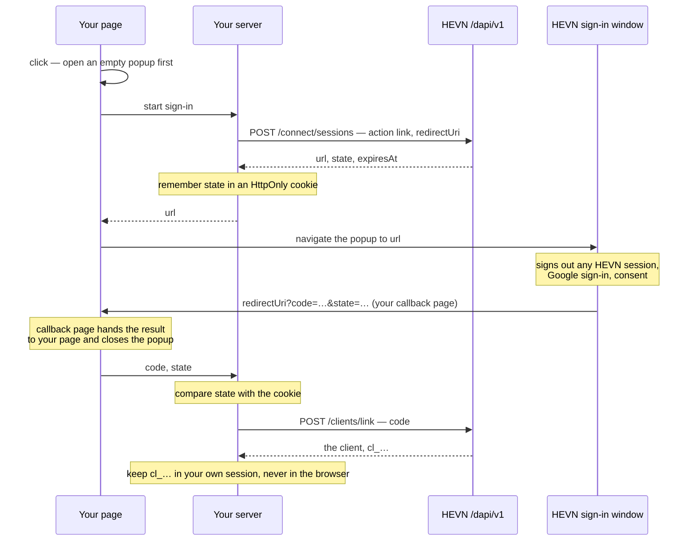

Sign in with HEVN is how a client comes to exist. Your customer signs in with Google in a HEVN-hosted popup on your site, allows your product to act on the account, and your backend exchanges the code that comes back for a `cl_…` id. The same popup is where the account holder later approves each payout you book for them.



The window takes nothing from your page but the session URL your server got from HEVN. It shows no HEVN product screens: a sign-in, one consent screen, and, for a payout, the terms being approved.

## Before you start

- **Your integrator account is active.** HEVN switches it on. Until it does, `POST /dapi/v1/connect/sessions` and `POST /dapi/v1/clients/link` answer `403 client_creation_not_enabled` — see [Going live](/whitelabel/going-live#what-hevn-must-enable).
- **Your site is an allowed origin.** In the HEVN app, open **Settings → Partner program → Developer** and find the **Sign-in window** card. Add every origin your callback page is served from under **Allowed sites**. A session for any other `redirectUri` is refused.
- **You have a callback page.** One static page on an allowed origin that hands the popup's result back to the page that opened it. It is shown [below](#the-callback-page).

## Configure the window

The **Sign-in window** card holds everything about how the popup looks and where it may return. Nothing about the window is configurable from the API or from the session URL: a page that opens the popup cannot restyle it, retitle it or redirect it.

| Setting | What it takes | Without it |
| --- | --- | --- |
| **Title** | Plain text, up to 60 characters. The window's heading and browser-tab title | HEVN's own headings |
| **Logo URL** | An `https://` image address | HEVN's logo |
| **Background**, **Accent** | `#rgb` or `#rrggbb`. Accent colours the main button | HEVN's colours |
| **Theme** | **Auto**, **Light** or **Dark** | Follows the viewer's system |
| **Allowed sites** | Up to 20 origins: `https://host`, or `http://localhost:<port>` and `http://127.0.0.1:<port>` for development. No path, no query | No session can be created |

The card shows a preview of the consent screen as you edit. Removing an allowed site also stops every session already issued for it: the window refuses to open a session whose `redirectUri` is no longer on the list.

## Link an account

### 1. Open the popup inside the click

Browsers block a popup that is not opened synchronously by a user gesture. Open an empty window first, inside the click handler and before any `await`, then ask your server for the session and point the window at it.

```javascript Browser
button.addEventListener("click", async () => {
  const popup = window.open("about:blank", "hevn-connect", "popup,width=460,height=720");
  if (!popup) return showError("Allow pop-ups for this site to sign in.");

  const { url } = await (await fetch("/hevn/link/start", { method: "POST" })).json();
  const result = await hevnResult(url, popup);           // below
  if (result.error) return showError(result.error);

  await fetch("/hevn/link/finish", {
    method: "POST",
    headers: { "content-type": "application/json" },
    body: JSON.stringify({ code: result.code, state: result.state }),
  });
});
```

### 2. Create a session on your server

`POST /dapi/v1/connect/sessions` is called with your own access token and **no** `X-Hevn-Account` — it is about your integrator account, so the header answers `400 account_scope_conflict`.

<CodeGroup>

```bash cURL
curl -X POST "$HEVN_API/connect/sessions" \
  -H "Authorization: Bearer $HEVN_ACCESS_TOKEN" \
  -H "Content-Type: application/json" \
  -d '{"action":"link","redirectUri":"https://app.example.com/hevn/callback"}'
```

```python Python
session = hevn.post("/connect/sessions", {
    "action": "link",
    "redirectUri": "https://app.example.com/hevn/callback",
})
```

```javascript Node
const session = await hevn.post("/connect/sessions", {
  action: "link",
  redirectUri: "https://app.example.com/hevn/callback",
});
```

```go Go
session, err := api.Post("/connect/sessions", hevn.Body{
	"action":      "link",
	"redirectUri": "https://app.example.com/hevn/callback",
})
```

</CodeGroup>

```json Response — 201
{
  "url": "https://sandbox.gethevn.com/connect?session=eyJhbGciOiJFUzI1NiIs…",
  "state": "pQ8v2Zr0cJ3mX7tLkN1wA5yHs9dE4fBq",
  "expiresAt": "2026-09-17T10:14:11Z"
}
```

<ParamField body="action" type="string" required>
  `link` asks the account holder to connect their account. `sign` asks them to approve one payout — see [Approve a payout](#approve-a-payout).
</ParamField>

<ParamField body="redirectUri" type="string" required>
  The page the window returns to. An `https://` URL — or `http://localhost` and `http://127.0.0.1` in development — with no fragment, on an origin listed under **Allowed sites**. Any other origin answers `403 redirect_uri_not_allowed`.
</ParamField>

<ParamField body="payoutId" type="string">
  The `po_…` to approve. Required for `sign`, refused for `link`.
</ParamField>

`url` opens the window and lives for about ten minutes, until `expiresAt`. HEVN signs it, and it is bound to your integrator account, the action, the payout, the `redirectUri` and a one-time nonce. `state` is that nonce: the window sends it back on `redirectUri` with the result, and nothing else ties the result to this session. Give `url` to the browser and keep `state` on your side.

### 3. Bind the session to this browser

Never let the browser tell your server which client it is. Remember `state` in an HttpOnly cookie when you create the session, and accept a code only when the browser returns the same `state` in that same cookie jar. A code arriving with no cookie, or with another `state`, came from somewhere else.

```javascript Node
app.post("/hevn/link/start", async (req, res) => {
  const session = await hevn.post("/connect/sessions", {
    action: "link",
    redirectUri: "https://app.example.com/hevn/callback",
  });
  res.cookie("hevn_link", sign({ state: session.state }), {
    httpOnly: true, secure: true, sameSite: "lax", path: "/hevn/link", maxAge: 10 * 60_000,
  });
  res.json({ url: session.url });
});
```

### 4. Exchange the code

The window returns a `code` that lives for five minutes and works only for your integrator account. Exchange it server-side, again with no `X-Hevn-Account`:

<CodeGroup>

```bash cURL
curl -X POST "$HEVN_API/clients/link" \
  -H "Authorization: Bearer $HEVN_ACCESS_TOKEN" \
  -H "Content-Type: application/json" \
  -d '{"code":"eyJhbGciOiJFUzI1NiIs…"}'
```

```python Python
client = hevn.post("/clients/link", {"code": code})
```

```javascript Node
app.post("/hevn/link/finish", async (req, res) => {
  const attempt = verify(req.cookies.hevn_link);
  res.clearCookie("hevn_link", { path: "/hevn/link" });
  if (!attempt || !timingSafeEqual(attempt.state, req.body.state)) {
    return res.status(400).json({ code: "state_mismatch" });
  }
  const client = await hevn.post("/clients/link", { code: req.body.code });
  req.session.clientId = client.id;      // your own signed session, never a browser field
  res.json({ signedIn: true });
});
```

```go Go
client, err := api.Post("/clients/link", hevn.Body{"code": code})
```

</CodeGroup>

```json Response — 200
{
  "id": "cl_7YQ2Kf3mN8",
  "status": "ready",
  "email": "ops@northwind.example",
  "baseSmartWallet": "0x2f1c9a3b7e5d41c8a06f2d9b4e7c15839af0d6b2",
  "kybStatus": "notStarted",
  "createdAt": "2026-09-17T10:04:11Z",
  "pollUrl": "/dapi/v1/client"
}
```

The answer is the [client record](/whitelabel/clients). Store `id` against your own user. From now on your server finds the client from its own session and sends that id in `X-Hevn-Account`; the browser never carries it, so no page can ask your server to act for somebody else's account. Exchanging the same code again returns the same client.

## The callback page

The window finishes by navigating to `redirectUri` with the result in the query string: `code` or `error` for a link, `status`, `payout` and `reference` or `error` for a payout, and `state` on every one. The callback page posts that query to the page that opened the popup over a `BroadcastChannel`, then closes the window.

```html callback.html
<!doctype html>
<meta charset="utf-8">
<title>Signing in…</title>
<script>
  const result = Object.fromEntries(new URLSearchParams(location.search));
  if (result.state) {
    const channel = new BroadcastChannel("hevn-connect");
    channel.postMessage({ state: result.state, result });
    channel.close();
    window.close();
  }
</script>
```

The opener listens on the same channel and settles only on the result that carries its own session's `state`:

```javascript Browser
function hevnResult(url, popup, timeoutMs = 10 * 60_000) {
  const token = new URL(url).searchParams.get("session");
  const body = token.split(".")[1].replace(/-/g, "+").replace(/_/g, "/");
  const { nonce } = JSON.parse(atob(body.padEnd(Math.ceil(body.length / 4) * 4, "=")));
  const channel = new BroadcastChannel("hevn-connect");
  return new Promise((resolve, reject) => {
    const timer = setTimeout(() => { channel.close(); reject(new Error("timeout")); }, timeoutMs);
    channel.onmessage = ({ data }) => {
      if (data?.state !== nonce) return;
      clearTimeout(timer);
      channel.close();
      resolve(data.result);
    };
    popup.location.href = url;
  });
}
```

The result does not travel through `window.opener`. Google's sign-in cuts the popup off from the page that opened it, so by the time the window returns, `window.opener` is `null`. A `BroadcastChannel` reaches every page of your origin in the same browser, which is why the callback page must live on the same origin as the page that opened the popup.

`state` on the result is the nonce inside the session token, and it equals the `state` field `POST /dapi/v1/connect/sessions` answered. The browser check only routes the result to the right page; the check that matters is your server's, against its cookie.

<Note>
  The Node reference at [hevn-inc/dapi-sdk](https://github.com/hevn-inc/dapi-sdk) ships this browser half as `HevnConnect`: `HevnConnect.open()` opens the popup synchronously in the click handler, `.link(url)`, `.sign(url)` and `.run(url)` navigate it and resolve with the result, and `HevnConnect.complete()` is the whole callback page. Like the rest of that repository, it is a working reference to read, not a supported package.
</Note>

## Who can be linked

Only an account created in the sign-in window can be linked. The window signs out any HEVN session in that browser before every `link` sign-in, so the holder always chooses the Google account explicitly, and:

| The person signing in | What happens |
| --- | --- |
| Has no HEVN account | The sign-in creates one, they allow access, and the window returns a `code`. |
| Already linked to **you** through an earlier sign-in | They sign in again and the window returns a new `code` for the same client. This is how a returning customer logs in to your product. |
| Already has a HEVN account of their own | The window refuses with `already_registered` and offers to open HEVN instead. An account someone already uses directly can never be handed to an integrator. |
| Is linked to another integrator | The window refuses with `already_linked`. |

The consent screen names your product — the **Title** you configured, or your account's name — and the origin of `redirectUri`, and says what you get: you can see balances, open accounts and prepare transfers, and the holder approves every transfer themselves in this window.

## Approve a payout

A payout you book for a linked client answers `authorization: "client"` and carries no approval for your key. The holder signs it. Create a `sign` session for that payout and open the popup exactly as for a link:

<CodeGroup>

```bash cURL
curl -X POST "$HEVN_API/connect/sessions" \
  -H "Authorization: Bearer $HEVN_ACCESS_TOKEN" \
  -H "Content-Type: application/json" \
  -d '{"action":"sign","payoutId":"po_6d21…","redirectUri":"https://app.example.com/hevn/callback"}'
```

```python Python
session = hevn.post("/connect/sessions", {
    "action": "sign",
    "payoutId": payout["id"],
    "redirectUri": "https://app.example.com/hevn/callback",
})
```

```javascript Node
const session = await hevn.post("/connect/sessions", {
  action: "sign",
  payoutId: payout.id,
  redirectUri: "https://app.example.com/hevn/callback",
});
```

```go Go
session, err := api.Post("/connect/sessions", hevn.Body{
	"action":      "sign",
	"payoutId":    payout.Str("id"),
	"redirectUri": "https://app.example.com/hevn/callback",
})
```

</CodeGroup>

The payout must belong to a client linked to you and still be `awaitingSignature`. Otherwise the session is refused with `404 payout_not_found` or `409 payout_not_awaiting_signature`.

In the window the holder signs in — a HEVN session already open in that browser is reused for `sign` — sees the amount, the contact's name and who requested it, and their own wallet signs the debit. The callback receives `status=submitted`, `payout=po_…` and, when the debit was sent, `reference`. A payout that was no longer waiting by the time the window opened comes back with its current `status` and nothing signed.

The redirect is a hint, never the record. Read `GET /dapi/v1/payouts/{payoutId}` with the client in `X-Hevn-Account` and follow it to `settled` like any other payout — see [Payouts](/whitelabel/payouts#approve-it-in-the-sign-in-window).

## Errors

Refusals come from two places. Your server sees the API's; your callback page sees the window's, as `error` on the redirect.

| Where | `code` | Cause | What to do |
| --- | --- | --- | --- |
| `POST /connect/sessions` | `403 redirect_uri_not_allowed` | The origin of `redirectUri` is not under **Allowed sites** | Add the origin in the **Sign-in window** card, or fix the URL |
| `POST /connect/sessions` | `422 validation_failed` | `redirectUri` is not `https://` (or local `http://`), carries a fragment, or `payoutId` is missing for `sign` or present for `link` | Fix the body |
| `POST /connect/sessions` | `404 payout_not_found`, `409 payout_not_awaiting_signature` | A `sign` session for a payout that is not a linked client's, or that no longer waits for a signature | Read the payout before you open the window |
| `POST /connect/sessions`, `POST /clients/link` | `403 client_creation_not_enabled` | Your integrator account is not active | Ask HEVN — see [Going live](/whitelabel/going-live#what-hevn-must-enable) |
| `POST /clients/link` | `400 link_code_invalid` | The code is malformed, was issued for another integrator, or the account is gone | Start a new sign-in |
| `POST /clients/link` | `410 link_code_expired` | The code is older than five minutes | Start a new sign-in |
| `POST /clients/link` | `409 client_already_linked` | The account is already connected to another integrator, or can no longer be connected to you | Nothing to retry. Tell your customer |
| Callback | `access_denied` | The holder chose **Deny** on the consent screen | Let them try again when they are ready |
| Callback | `already_registered` | The Google account already has a HEVN account of its own | It cannot be linked. Ask your customer to sign in with another Google account |
| Callback | `already_linked` | The account is connected to another integrator | Nothing to retry |
| Callback | `not_found` | The signed-in holder does not own the payout, or it is not linked to you — usually the wrong Google account | Ask the holder to sign in with the account they linked |
| Callback | `unsupported` | This payout cannot be approved in the window | Book a payout the window can fund — see [Payouts](/whitelabel/payouts#approve-it-in-the-sign-in-window) |
| Callback | `expired` | The session ran out while the holder was in the window | Create a new session |
| Callback | `failed` | Anything else | Create a new session and try again |

A session that is invalid or already expired when the window opens never reaches your callback: the window shows *This link has expired or is invalid* and sends nothing back. Give up on the opener side once `expiresAt` has passed, and close the popup.

<Card title="Next: Clients" icon="building-2" href="/whitelabel/clients">
  Read the linked client, wait for it to be ready, and keep the one id that identifies it.
</Card>
