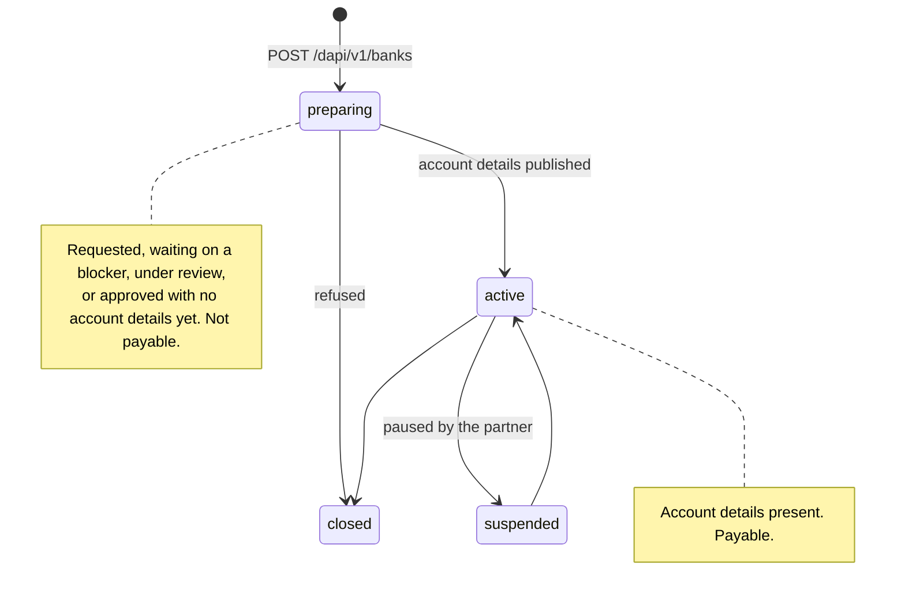

import ActingAsSnippet from "/snippets/acting-as.mdx";

A **product** is a region a client can be paid in — `eu`, `us`, `uk`, `swift`, `br`, … — and it is what you ask for. HEVN picks the **rail** behind it: the bank route that serves that product for this client. Asking gives the client a **virtual account** — a `bnk_…` record in the client's own legal name — and the virtual account publishes **account details**: the IBAN, the account and routing number or the PIX key its payers wire to. Money that arrives there is converted **by the partner bank** and delivered to the client's wallet.

The product is the key you use; the rail is informational; the virtual account is what you get; the account details are what you hand the payer. On the wire the details arrive in a field called `requisites`.

Requesting one is a single call. It never refuses because something is missing — the record is created and tells you what it still waits for:

<CodeGroup>

```bash cURL
curl -X POST "$HEVN_API/banks" \
  -H "Authorization: Bearer $HEVN_ACCESS_TOKEN" \
  -H "X-Hevn-Account: $HEVN_CLIENT_ID" \
  -H "Content-Type: application/json" \
  -d '{"product":"eu"}'
```

```python Python
northwind = hevn.acting_as(CLIENT_ID)

bank = northwind.post("/banks", {"product": "eu"})
for blocker in bank.get("blockers", []):
    print(blocker["code"], blocker["message"])
```

```javascript Node
const northwind = hevn.actingAs(clientId);

const bank = await northwind.post("/banks", { product: "eu" });
for (const blocker of bank.blockers ?? []) console.log(blocker.code, blocker.message);
```

```go Go
northwind := api.ActingAs(clientID)

bank, err := northwind.Post("/banks", hevn.Body{"product": "eu"})
for _, blocker := range bank.List("blockers") {
	fmt.Println(blocker.Str("code"), blocker.Str("message"))
}
```

</CodeGroup>

Examples use the client from [HTTP client](/whitelabel/reference/client). Every route on this page is client-scoped, so every call carries the account header:

<ActingAsSnippet />

## Four statuses



A virtual account is payable when `status` is `active`. That is the whole rule — `active` is only reported once the account details exist, so there is no second condition to check and no client-side branch to write. A product you have not requested has no `status` at all.

`suspended` is the partner pausing the account; money already in flight still settles, new payments do not start. `closed` is terminal.

<Note>
  In production a virtual account is opened by review, not by your call. `POST /dapi/v1/banks` answers `201` with `status: "preparing"` and the record becomes `active` when the partner publishes the account details — hours to days, depending on the product and the client's jurisdiction. In the sandbox that review is emulated and the record activates as soon as nothing blocks it.
</Note>

## What the client can request

`GET /dapi/v1/banks` returns one record per product this client can be paid in — the ones already requested, with their status, and the ones still open to it:

<CodeGroup>

```bash cURL
curl "$HEVN_API/banks" \
  -H "Authorization: Bearer $HEVN_ACCESS_TOKEN" \
  -H "X-Hevn-Account: $HEVN_CLIENT_ID"
```

```python Python
catalogue = northwind.get("/banks")
```

```javascript Node
const catalogue = await northwind.get("/banks");
```

```go Go
catalogue, err := northwind.Get("/banks")
```

</CodeGroup>

```json
{
  "rails": [
    {
      "product": "eu",
      "rail": "sepa-eur-usdc-kappa",
      "currency": "EUR",
      "railCurrency": "USDC",
      "method": "sepa",
      "opened": false,
      "feeBps": 25,
      "supportedAccounts": ["USDC"]
    },
    {
      "product": "us",
      "rail": "ach-usd-usdc-sigma",
      "currency": "USD",
      "railCurrency": "USDC",
      "method": "ach",
      "opened": true,
      "status": "active",
      "id": "bnk_88Hq3T",
      "feeBps": 25,
      "supportedAccounts": ["USDC"],
      "destinationAccount": "USDC",
      "minimumDeposit": "1.00",
      "requisites": { "…": "…" }
    }
  ]
}
```

The list is the client's own catalogue: a product nothing can serve for this client — its residency, its type, or no partner in that region — is not in it. `GET /dapi/v1/banks/{product}` returns one record in the same shape.

`product` is the key: it is what you send, what the path takes and what `Location` points at, and it is the same in every environment. `rail` names the route HEVN chose behind it. It is informational — do not store it, branch on it or show it — and it can change while a record is still `preparing`, when HEVN re-routes the request to another partner. The products and the methods behind them are in the [rail reference](/whitelabel/reference/rails).

## Request it

```json
{ "product": "eu" }
```

`201 Created`, `Location: /dapi/v1/banks/eu`, body is the record with `status: "preparing"`. A virtual account is a singleton per client and product, so requesting one twice is safe: the second call answers `200` with `Idempotency-Replayed: true` and the same record, whether the first one is still preparing or already active. `Idempotency-Key` is accepted and unnecessary here.

Two refusals are worth branching on: `403 rail_not_available` with `details.product` means nothing can serve this product for this client, and `422 validation_failed` means the product code is not one HEVN knows. The rest are in the [error reference](/whitelabel/reference/errors).

Request products one at a time — a client that needs EUR and USD is two calls.

## What still blocks it

A record that is `preparing` carries `blockers[]`: everything that stands between the request and active account details. Nothing on this list refuses the request — the record waits, and moves on its own once the blocker clears.

```json
{
  "product": "eu",
  "rail": "sepa-eur-usdc-kappa",
  "currency": "EUR",
  "method": "sepa",
  "opened": true,
  "status": "preparing",
  "id": "bnk_4Tq9Wd",
  "blockers": [
    {
      "code": "kyb_required",
      "field": "kyb",
      "message": "The client's business verification has to be completed before this account can open."
    }
  ]
}
```

There are three, and each has a single fix:

| `code` | Cleared by |
| --- | --- |
| `kyb_required` | A business client's KYB application reaching `approved` — see [Onboarding](/whitelabel/onboarding). |
| `verification_required` | A linked individual verifying their identity. Open a `verify` session for the client in the [sign-in window](/whitelabel/sign-in-with-hevn#verify-an-individual); the holder verifies there, never through you. |
| `terms_required` | The client accepting the partner bank's terms. `url` is the page the client opens to accept them. |

`message` is safe to show your customer as is. `url` is present only when there is a page the client itself opens; `verification_required` on a linked individual never carries one, because the sign-in window needs your `redirectUri`. Re-read the record rather than tracking blockers yourself: `GET /dapi/v1/banks/{product}` answers what is left.

## Read the account details

Once the record is `active`, it carries the details a payer needs. They are in the client's own legal name:

```json
{
  "product": "eu",
  "rail": "sepa-eur-usdc-kappa",
  "currency": "EUR",
  "method": "sepa",
  "opened": true,
  "status": "active",
  "id": "bnk_88Hq3T",
  "destinationAccount": "USDC",
  "minimumDeposit": "1.00",
  "requisites": {
    "fields": { "iban": "DE89370400440532013000", "bic": "BANKDEFFXXX" },
    "holder": { "type": "business", "businessName": "Northwind Trading Ltd" },
    "bankName": "Bank A",
    "state": "active"
  }
}
```

`fields` carries only the identifiers this method uses — an IBAN for SEPA, an account and routing number for ACH, and so on; the full matrix is in the [rail reference](/whitelabel/reference/rails). The shape is `RailRequisitesView` on a virtual account and `ContactPaymentAccountView` on a [contact](/whitelabel/payouts#save-a-contact); both carry the same `fields`, `holder` and `bankName`.

`id` is the `bnk_…` a statement or a transaction filter refers to. Store it alongside the product.

Two numbers travel with the record. `minimumDeposit` is the smallest amount the partner will accept, in the product's own currency; anything under it is returned by the bank, not by us. `feeBps` is HEVN's deposit fee in basis points — `25` is 0.25%, taken out of the converted amount. It comes from the client's plan, so two clients can read different values for the same product.

### What the payer sees

On a named account the partner bank opens the account in the client's own legal name, so the payer's bank shows the client and nothing about HEVN. Hand your customer the `fields`, the `holder` name and `bankName` exactly as they come back, and re-read them before each use rather than caching them — a partner can republish an account.

When the account details carry a `paymentReference`, the account is pooled: it belongs to the partner, and the reference is what separates one client's money from another's, so a payment that arrives without it cannot be attributed. Hand the reference over with the rest, every time.

## Which stablecoin a deposit settles in

`railCurrency` is what the rail delivers, `supportedAccounts` is which of the client's accounts it can deliver into, and `destinationAccount` is where it delivers today. None of them is something you set: **the rail decides, and HEVN picks the rail for the product.** Read them back, never cache them.

The choice that is yours per payment is on the money-in side. `POST /dapi/v1/payins` takes `destinationAccount` and quotes the deposit in it; when no virtual account of the client's settles into the account you asked for, the refusal carries `details.options[]` with the pairs that do ([Payins](/whitelabel/payins)). Nothing on this page converts an existing balance — `destinationAccount` only ever names where money that has not arrived yet will land. Converting what already arrived is [Swaps](/whitelabel/swaps).


<Card title="Next: Payins" icon="arrow-right" href="/whitelabel/payins">
  Quote an incoming payment, hand the payer instructions, and watch it settle.
</Card>
